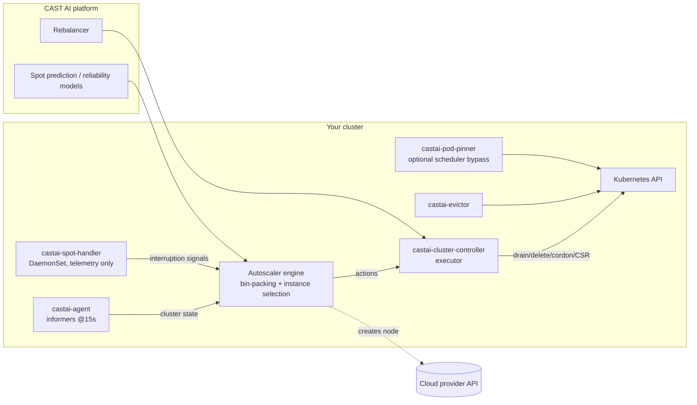

# CAST AI Node Autoscaler — Production Engineering Handbook

> **Status:** ✅ COMPLETE — assembled from live research of https://docs.cast.ai on 2026-10-17 (all facts carry a research snapshot date; CAST AI ships weekly — re-verify before major adoption decisions).
> Conventions used throughout:
> - **[Doc]** = stated in official CAST AI documentation (source URL cited).
> - **[Engineering]** = field recommendation/practice, not a CAST AI product default.
> - **[Unverified]** = could not be confirmed in documentation; validate before use.
> - All `.md` page mirrors verified reachable with HTTP 200 unless noted.
> - Numeric defaults are given **only** where the docs state them.

---

## Documentation coverage matrix

| Group | Pages fetched | Status |
|---|---|---|
| Core Autoscaler (autoscaler, checklist, settings, node-templates, node-configuration, pod-placement, pod-pinner, labels/taints, troubleshooting, daemonsets) | 10 of 10 | ✅ complete |
| Capacity types (spot, spot-prediction-API, gpu, gpu-sharing ×5, storage, tpu, neuron, dra, arm) | 13 of 13 | ✅ complete |
| Downscale/Evictor/Rebalance/CLM (14 pages) | 14 of 14 | ✅ complete |
| Networking/commitments/onboarding (14 pages) + read-only-agent/api-access/PSC (3) | 17 of 17 | ✅ complete |
| Components/Helm/Terraform/castctl/ops (16 pages) | 16 of 16 | ✅ complete |
| Pod mutations (4 pages) | 3 of 3 core (overview, reference, quickstart) | ✅ complete |
| FinOps/savings + adjacent (12 pages) | 12 of 12 | ✅ complete |
| Changelog (Aug 2025–Sep 2026) + REST API reference (policies v2, evictor, templates, configurations, rebalancing, schedules) | ✅ | ✅ complete |

---

## Executive summary

This handbook turns ~95 verified CAST AI documentation pages, 9 API reference pages and 14 months of changelogs into an opinionated engineering guide to the **CAST AI Node Autoscaler** (EKS/GKE/AKS). It is built for platform engineers running it in production.

**Architecture in one line [Doc]:** a remote SaaS control plane watches your cluster through the ~15-second agent sync, bin-packs unschedulable pods, picks the cheapest fitting instance (commitments/reservations first when assigned), and pushes actions to in-cluster executors; scale-down is limited to *empty* nodes unless Evictor (bin-packing) or the Rebalancer (node replacement) deliberately create the emptiness. Expect nodeAdds in 60–120 s.

**The levers that matter most:**
1. **Node Templates** (scheduling constraints, spot strategy, CLM, reservations, GPU sharing, per-template CPU caps) and **Node Configurations** (versioned boot/network/storage; new nodes only). Chapters 5–6.
2. **Policies**: unschedulable-pods (required for *all* rebalancing — TF default false is a foot-gun), cluster max-CPU cap, empty-node delay (API default 300 s), scoped mode for brownfield. Chapter 4.
3. **Downscale duo**: Evictor (60 s cycles, 5-min grace, 20 targets/cycle defaults; PDBs *always* respected) vs Rebalancer (plan/execute schedules, graceful `drain-failed` handling, savings gates). Chapters 8/10.
4. **Spot safety stack**: fallback + re-review interval, interruption prediction (1 h AWS / 3 h GCP), reliability tolerance 0–100 %, per-template CPU caps, self-service interruption simulation. Chapter 9.
5. **FinOps loop**: realized = projected − actual; ≥20 % adoption gates; ≥14-day baseline maturity; commitments feeding top-priority template tiers. Chapter 14.

**Known documentation gaps flagged, not invented:** CAST AI fee treatment in savings math, projection formulas, empty-node TTL prose default vs API's 300 s, GPU-sharing support contradiction between pages, 3 h vs 1800 s drain-failure uncordon default. No benchmark numbers exist in the docs — Part 4 is a test *method* you fill in with your own measurements.

---

## Chapter 1 — Architecture and internals  ✅

*Sources: [autoscaler](https://docs.cast.ai/docs/autoscaler), [hosted-components](https://docs.cast.ai/docs/hosted-components), [pod-pinner](https://docs.cast.ai/docs/pod-pinner), [autoscaler-reference-node-labels-and-taints](https://docs.cast.ai/docs/autoscaler-reference-node-labels-and-taints), [autoscaler-checklist](https://docs.cast.ai/docs/autoscaler-checklist) — read 2026-10-17.*

### 1.1 The four-step control loop **[Doc]**

The CAST AI Autoscaler is a **remote optimizer**: intelligence runs in the CAST AI platform (SaaS); your cluster only runs lightweight components that stream state out and execute decisions in.

1. **Watching** — the CAST AI Kubernetes Agent uses Kubernetes informers to watch cluster resources and synchronizes all changes to CAST AI at **15-second intervals**.
2. **Calculating** — the platform computes required extra capacity and detects empty nodes.
3. **Evaluating** — required capacity is converted into optimal node instance types.
4. **Provisioning / removing** — new right-sized nodes are created, underutilized **empty** nodes removed.



### 1.2 Exact trigger & detection semantics **[Doc]**

- **Unschedulable pod** (verbatim definition): a pod in `Pending` phase with its `PodScheduled` condition set to `False` and reason `Unschedulable`. *Nothing else triggers scale-up* — high CPU utilization on existing nodes is **not** a scale-up signal.
- **Empty node** (verbatim definition): a node without any running pods. The Autoscaler **ignores exited, static, or DaemonSet pods** when determining emptiness.
- **Watched resources** (informers): `Node`, `Pod`, `PersistentVolume`, `PersistentVolumeClaim`, `ReplicationController`, `Service`, `Deployment`, `ReplicaSet`, `DaemonSet`, `StatefulSet`, `StorageClass`, `Job`, `CSINode`, `HorizontalPodAutoscaler`.
- **DaemonSet accounting**: the autoscaler examines **both** DaemonSet specs and actual running DaemonSet pods and uses the **higher** of the two request values for capacity planning (this is what keeps Workload-Autoscaler-modified DaemonSets from causing scale loops) **[Doc]**.

### 1.3 Capacity math → instance choice **[Doc]**

1. Bin-packing: groups pending pods, respecting declared constraints — documented as an **NP-hard** problem with approximation strategies as pod counts grow (expect heuristic, not mathematically perfect, packing on large bursts).
2. Instance type selection, per packed group: filter all available instance types → sort viable candidates by price → **select the cheapest type satisfying every constraint**. Pricing/availability inventory is refreshed continuously from cloud-provider APIs.
3. Constraints that shape the filter: node template constraints (Ch 5), node configuration network placement (Ch 6), pod nodeSelector/required nodeAffinity (only operator `In` on template key)/tolerations, PVC zone bindings, topology-spread feasibility, cluster + template CPU limits.

### 1.4 Topology-spread and zone semantics (table [Doc])

| Term | Meaning |
|---|---|
| **Spread domain** | A zone holding ≥1 *eligible* node; zones without eligible nodes are invisible to the scheduler's spread check |
| **Eligible node** | Node the pod could run on (pod's nodeSelector/required nodeAffinity; plus tolerations when `nodeTaintsPolicy: Honor`) |
| **Cluster zones** | All AZs configured on the cluster |
| **Provisioning zones** | Zones the autoscaler may create nodes in, after Node Template + Node Configuration restrictions |
| **Bound zones** | Zones of the pod's PVCs — *"a pod stays with its data"* |

Zone-picking order of the autoscaler **[Doc]**: cluster zones ∩ pod zone selector/affinity → intersect template AZ list (empty overlap = blocked) → keep PVC-bound zones → (AWS only) zone must have a subnet in the Node Configuration → assign least-populated allowed zone that keeps maxSkew → set pod zone nodeSelector → create node.
⚠️ Only `whenUnsatisfiable: DoNotSchedule` makes the autoscaler create nodes in *new* fault domains; `ScheduleAnyway` keeps bin-packing on existing domains. `minDomains` is **not supported**.

### 1.5 Node birth sequence (EKS; other clouds analogous)

1. Node template + configuration selected → cloud instance created (labels/taints from template).
2. Node joins cluster; `provisioner.cast.ai/uninitialized:NoSchedule` taint holds scheduling until init completes **[Doc]**.
3. Cluster-controller approves the kubelet CSR **[Doc]**; Amazon CNI assigns IPs per the max-pods/prefix-delegation math (Ch 6).
4. Pods bind. With **Pod Pinner** enabled, the autoscaler streams *specific* node assignments: Pod Pinner creates a placeholder Node object and binds the pod via the `/pods/binding` API (`spec.nodeName`); the real node "attaches" to the placeholder on join. If Pod Pinner fails, the kube-scheduler simply takes over — no downtime risk **[Doc]**.

### 1.6 Component responsibility matrix **[Doc]**

| Component | Kind | Job | Never does |
|---|---|---|---|
| castai-agent | Deployment | Stream cluster state (15s) | Modify workloads |
| castai-cluster-controller | Deployment | Execute platform actions: create/drain/delete nodes, labels, CSR approvals | Decide *what* to scale |
| castai-evictor | Deployment | Bin-pack non-empty nodes via evictions (Ch 8) | Scale up |
| castai-pod-pinner | Deployment (0→2 replicas when enabled, K8s ≥1.27) | Bind pods to planned nodes, rebalancing precision | — |
| castai-spot-handler | DaemonSet | Report provider interruption signals | Drain/cordon/act |
| castai-pod-mutator | Webhook | Mutate pod specs at creation | — |
| castai-live | Deployment | Container Live Migration controller | — |
| castai-kvisor | DaemonSet | Observability/security telemetry | — |
| castai-watchdog | Deployment (GKE, Early Access) | Emergency provisioning when CAST AI is down | Cost optimization |

### 1.7 What the autoscaler cannot see (documented limits)

- **Custom/extended resources cannot drive upscaling** (e.g. a customer device plugin's `example.com/foo: 1`): *"the Cast AI autoscaler cannot provision new nodes based on arbitrary custom resource requests"* **[Doc]**. Pods stay Pending. CAST AI can still move such pods onto *existing* nodes advertising the resource (e.g., during rebalancing).
- **Provider-native labels are ignored** in its scheduling simulation: *"Provider-native labels such as GKE's `cloud.google.com/machine-family` or Karpenter's `karpenter.k8s.aws/instance-family` are not evaluated by the autoscaler"* — use `scheduling.cast.ai/*` equivalents **[Doc]**.
- GPU-family exceptions are first-class: `nvidia.com/gpu`, `google.com/tpu` (GKE), `aws.amazon.com/neuron` (EKS) **do** drive scaling **[Doc]** (see capacity appendix).
- `minDomains`, hostname-topology pod affinity **[Doc]**, and soft (`ScheduleAnyway`) spreads are not provisioning instructions.

### 1.8 Who scales what — keeping six controllers straight **[Doc/Engineering]**

| Controller | Scales | Trigger | Time to effect |
|---|---|---|---|
| HPA | Pod replica count | metrics (CPU/custom) | seconds (pods) |
| Workload Autoscaler (VPA) | Pod CPU/memory requests | usage percentiles | rolling restarts / in-place (K8s 1.33+) |
| **Node Autoscaler** | Node count/types | unschedulable pods; empty nodes | new node typically **60–120s** [Doc, business-continuity] |
| **Evictor** | Pod placement (fewer nodes) | consolidation feasibility | minutes |
| **Rebalancer** | Node replacement (cheaper/cleaner) | price/config drift/savings threshold | per-plan |
| Pod Pinner | exact pod↔node binding | rebalancing/scale plans | instant binding |

Rule of thumb: HPA/WOOP change **demand**, Node Autoscaler right-sizes **supply**, Evictor/Rebalancer **defragment and re-price** supply.

## Chapter 2 — Prerequisites and production readiness  ✅

*Sources: [connecting-your-cluster](https://docs.cast.ai/docs/connecting-your-cluster), [autoscaler-checklist](https://docs.cast.ai/docs/autoscaler-checklist), [cloud-permissions](https://docs.cast.ai/docs/cloud-permissions), [kubernetes-permissions](https://docs.cast.ai/docs/kubernetes-permissions), [communication-requirements](https://docs.cast.ai/docs/communication-requirements), [aws-privatelink](https://docs.cast.ai/docs/aws-privatelink), [hosted-components](https://docs.cast.ai/docs/hosted-components), [watchdog](https://docs.cast.ai/docs/watchdog).*

### 2.1 Compatibility gate — read first **[Doc]**

CAST AI must be the **sole node autoscaler**. Running alongside Kubernetes Cluster Autoscaler (CA) causes conflicts **[Doc]**. Documented **incompatible** environments: **GKE Autopilot, EKS Auto Mode, EKS Fargate, AKS Automatic, clusters running cluster-autoscaler** (use *CAST AI Anywhere* for those — workload optimization without node management). Karpenter-native clusters: use the Karpenter Enterprise suite — *"Running Cast AI's standard node autoscaler and Karpenter together in the same cluster is not supported and will result in undefined behavior"* **[Doc]**.

### 2.2 Version and component minimums **[Doc]**

| Requirement | Minimum |
|---|---|
| Kubernetes for Pod Pinner | ≥ 1.27 |
| Kubernetes for CLM | ≥ 1.30 (checkpoint/restore Beta) |
| Kubernetes for DRA GPU | ≥ 1.34 |
| Helm (for `--reset-then-reuse-values`) | ≥ 3.14.0 |
| Terraform (EKS GitOps) | ≥ 1.3.2 |
| Pod mutations | castai-agent chart ≥ 0.123.0, cluster-controller ≥ 0.85.0 |
| Hibernation CriticalAddonsOnly toleration | agent ≥ 0.139.0, cluster-controller ≥ 0.90.0, pod-mutator ≥ 0.6.0, pod-pinner ≥ 1.12.0, workload-autoscaler ≥ 0.1.190 |
| EKS nodes on K8s ≥ 1.33 | AL2023 or Bottlerocket only (AL2 EOL) |
| CLM nodes | AL2023 + containerd v2+ (EKS); Bottlerocket/AL2 excluded |

### 2.3 Cloud permissions (automation phase) **[Doc]**

- **AWS:** dedicated IAM role + instance profile strongly advised — do **NOT** share the role with EKS Managed Node Groups (deleting the last MNG strips the role from `aws-auth` → Node registration failures). Managed policies `AmazonEC2ReadOnlyAccess` + `IAMReadOnlyAccess` plus the documented custom policy (RunInstances scoped by VPC + `kubernetes.io/cluster/<cluster>` tags, autoscaling/launch-template/EKS actions, PassRole to EC2/EKS). Trust principal: `arn:aws:iam::809060229965:user/cast-crossrole-<cluster-id>` with `sts:ExternalId=<cluster-id>`. Extras: `ec2:AttachVolume/DetachVolume` on the node role for EBS; `ec2:AssignIpv6Addresses` for IPv6.
- **GCP:** SA `castai-gke-<hash>` w/ custom role `castai.gkeAccess` (full verb list documented: instanceGroupManagers, instances CRUD, templates, container CSR approve/cluster get+update…) + `iam.serviceAccountUser`; `roles/container.developer` **no longer required** for onboardings after 2024-08-19 (removal command documented). APIs: `cloudresourcemanager`, `serviceusage`.
- **Azure:** custom role `CastAKSRole-<cluster-id-8>` on up to 3 resource groups (cluster RG, node RG `MC_*`, VNet RG — the last only when VNet is outside the cluster RG, and the onboarding identity then needs `roleAssignments/write` there). AKS workload-identity impersonation supported as alternative.
- The read-only **agent** additionally needs `ec2:DescribeInstances` to detect spot vs on-demand **[Doc]**.

### 2.4 Network / egress **[Doc]**

| Flow | Destinations |
|---|---|
| Component → CAST AI | `api[.eu|.india].cast.ai`, `grpc[…].cast.ai` (Pod Pinner), `kvisor.*` (India: `api-grpc.india.cast.ai`), `files[…].cast.ai` — all :443 |
| Images | `ghcr.io/castai/images` (default), `us-docker.pkg.dev/castai-hub/library` (fallback); overrides via `autoscaler.<component>.image.repository` |
| Helm/charts | `castai.github.io`, `objects/release-assets.githubusercontent.com`, `releaseassetproduction.blob.core.windows.net` |
| Node bootstrap | `storage.googleapis.com/castai-node-components/`, `…/castai-node-logs-sender/` |
| Webhooks | kube-apiserver → workload-autoscaler webhook **:9443** (configurable) |
| Static API IPs (allowlist) | US `104.16.81.56/82.56`; EU `141.101.90.96–99`; India `172.65.90.8–11` |
| CAST AI egress IPs (for inbound-restricted clouds) | US `34.48.199.96, 35.221.25.73, 34.48.86.252, 34.86.37.231`; EU `34.141.71.171, 34.89.180.238, 35.246.207.216, 34.89.186.65`; India `34.14.155.44, 34.47.196.217, 35.200.215.233, 34.100.217.237` |

Private clusters: AWS PrivateLink (4 interface VPC endpoints per region; subnets tagged `cast.ai/routable=true`; **private ECR mirror mandatory; upgrades then manual**) or GCP PSC (single endpoint + wildcard DNS) **[Doc]**. Corporate proxy: `HTTP_PROXY/HTTPS_PROXY/NO_PROXY` env through `additionalEnv` (NO_PROXY must include pod/service CIDRs + `*.cluster.local` + cloud metadata endpoints) **[Doc]**.

### 2.5 Workload readiness gates **[Doc, checklist]**

1. **PDBs on every critical workload** — verbatim warning: *"Without a PDB, Evictor may evict all pods of a deployment simultaneously."* Minimum: `minAvailable: 1`.
2. `imagePullPolicy` ≠ `Always` (pull delays; hard failure if the registry is unreachable during replacement).
3. Startup probes for slow booters; pod startup must fit `nodeGracePeriodMinutes` (**default 5 min**) or new nodes get evicted from under booting workloads.
4. StatefulSets reviewed individually (replication, restart tolerance).
5. DaemonSets multi-arch if ARM is planned; DS requests realistic (autoscaler plans nodes for the **higher** of spec vs running DS pods).
6. Storage: volumeBindingMode reviewed per cloud (wait-for-first-consumer where required); storage classes zone-compatible.
7. metrics-server installed (efficiency reports, WOOP).

### 2.6 Production-readiness checklist (PASS/FAIL)

| # | Gate | PASS criteria |
|---|---|---|
| 1 | Sole autoscaler | No cluster-autoscaler/Karpenter active (or documented delayed-fallback config from Ch 14 §business-continuity) |
| 2 | Components green | `kubectl get pods -n castai-agent` all Running; agent + cluster-controller registered in console |
| 3 | Policies | Unscheduled Pods policy ON; ≥1 enabled node template; node deletion policy configured |
| 4 | IAM | No shared instance profile with MNGs; documented policy set applied; AccessDenied absent from logs |
| 5 | Network | Egress per 2.4 verified from a component pod |
| 6 | PDBs | `kubectl get pdb -A` covers every critical deployment; no `ALLOWED DISRUPTIONS: 0` surprises |
| 7 | Slow starters | worst-case pod start < `nodeGracePeriodMinutes` (or value raised) |
| 8 | Storage | node-config disk/IOPS/throughput/KMS reviewed; CSI drivers on template-tolerations |
| 9 | Spot plan | templates mark lifecycle; workloads carry spot tolerations; fallback decision made |
| 10 | Resilience game-day | test workload scaled up/down; nodes added/removed as expected; drain labels observed |
| 11 | Observability | audit log accessible; notifications channel (Slack/webhook) configured |
| 12 | Rollback | documented: disable policies → scale back → fallback autoscaler reactivation tested |

### 2.7 Security posture of the data feed **[Doc]**

Read-only mode: informers only; no Secrets/ConfigMaps; env-var literal values matching `passwd|pass|password|pwd|secret|token|key|creds|credential` scrubbed pre-egress in-cluster. Kubernetes RBAC per component is fully enumerated on the kubernetes-permissions page (agent ≤ read + scoped patches; cluster-controller includes pods/eviction + CSR approval + `escalate` on Cast component RBAC; evictor: pods get/patch/delete + pods/eviction).

## Chapter 3 — Installation and onboarding  ✅

*Sources: [hosted-components](https://docs.cast.ai/docs/hosted-components), [helm-charts](https://docs.cast.ai/docs/helm-charts), [terraform-provider](https://docs.cast.ai/docs/terraform-provider), [terraform-provider-eks](https://docs.cast.ai/docs/terraform-provider-eks), [terraform-troubleshooting](https://docs.cast.ai/docs/terraform-troubleshooting), [castctl-import-cluster-configuration](https://docs.cast.ai/docs/castctl-import-cluster-configuration), [castctl-reference](https://docs.cast.ai/docs/castctl-reference), [component-control](https://docs.cast.ai/docs/component-control), [castai-operator](https://docs.cast.ai/docs/castai-operator), [about-the-read-only-agent](https://docs.cast.ai/docs/about-the-read-only-agent), [api-access](https://docs.cast.ai/docs/api-access), [gcp-private-service-connect](https://docs.cast.ai/docs/gcp-private-service-connect), [upgrading-kubernetes-version](https://docs.cast.ai/docs/upgrading-kubernetes-version), [troubleshooting-certificate-rotation](https://docs.cast.ai/docs/troubleshooting-certificate-rotation), [cluster-onboarding-troubleshooting](https://docs.cast.ai/docs/cluster-onboarding-troubleshooting), [component-troubleshooting](https://docs.cast.ai/docs/component-troubleshooting) — read 2026-10-17.*

### 3.1 Deployment anatomy (what gets installed where)

- All CAST AI components live in namespace **`castai-agent`** — the only supported namespace **[Doc]**. (Edge/OMNI components use `castai-omni`.)
- Helm repo for everything: `helm repo add castai-helm https://castai.github.io/helm-charts`.
- The **umbrella chart** `castai-helm/castai` deploys components by **mode tags** — exactly ONE tag may be true at a time; setting multiple true makes `helm upgrade` fail validation **[Doc]**:

| Mode tag | Provides | Components added |
|---|---|---|
| `tags.readonly=true` | Cost visibility + security telemetry | castai-agent, castai-spot-handler, castai-kvisor |
| `tags.workload-autoscaler=true` | Right-sizing of workload requests | + cluster-controller, evictor, pod-mutator, workload-autoscaler, workload-autoscaler-exporter |
| `tags.node-autoscaler=true` | **Node provisioning + bin-packing** | + cluster-controller, evictor, pod-mutator, **pod-pinner, castai-live (CLM)** |
| `tags.full=true` | Node + Workload autoscaling | everything |

Individual components can be force-enabled/disabled via `autoscaler.<component>.enabled` overrides (they beat the mode tag) **[Doc]**.

- Helm ≥ **3.14.0** required for the documented `--reset-then-reuse-values` upgrade pattern **[Doc]**.
- **[Engineering]** Detect how a cluster was installed: `helm list -n castai-agent` — a single release named `castai` = umbrella chart; separate releases (`castai-agent`, `castai-evictor`, …) = individual charts.

**Component role map** **[Doc]**: `castai-agent` = cluster-state snapshots to SaaS (informer sync); `castai-cluster-controller` = executes platform actions (node drains/deletes, labels, CSR approvals, CLM ops); `castai-evictor` = bin-packing evictions; `castai-pod-pinner` = placement control; `castai-live` = CLM controller (enabled per node template); `castai-spot-handler` = interruption telemetry *only*; `castai-kvisor` = observability/security; `castai-pod-mutator` = admission mutations; `castai-watchdog` = out-of-band outage fallback (GKE, Early Access); `castai-kentroller` = Karpenter integration; `castware-operator` = component lifecycle manager.

### 3.2 Method 1 — castctl (fastest, CLI-driven)

```shell
castctl auth login                     # token stored in ~/.config/castctl/config.yaml
castctl cluster connect \
  --provider <eks|gke|aks> \
  [--cluster-optimization=true] \      # enable Phase 2 automation
  [--import-config] \                  # discover existing node groups post-connect
  [--umbrella-values-file ./values.yaml] \  # extra umbrella chart values, e.g. pod-mutator enforcer
  [--dry-run]                          # print config YAML, change nothing
castctl version
```

**[Doc]** behavior contract:
- `--dry-run` skips changes entirely (import-config included).
- Under `castctl cluster connect --import-config`, the import step can fail while connect succeeds — the cluster stays connected; retry with `castctl cluster import-config`.
- Onboarding generates **one API key per cluster**; re-running castctl generates a *new* key and existing component pods may need deletion if they fail with 401s **[Doc]**.
- On EKS, castctl (and the TF module) automatically set `EKS_ACCOUNT_ID`/`EKS_REGION`/`EKS_CLUSTER_NAME` on the agent — manual Helm installs must add them via `additionalEnv` or the agent hits IMDS timeouts (169.254.169.254) **[Doc]**.

### 3.3 Method 2 — Console (+ Cast AI Operator)

- **Phase 1 (read-only)** script deploys `castware-operator`, which installs/upgrades **castai-agent + castai-spot-handler**. The operator self-upgrades; one pod restart for cert generation is expected. Console shows "Connecting…" until the agent registers (>10 min = troubleshooting case #8 below).
- **Phase 2 (automation)** installs **castai-cluster-controller** — recommended via the Operator with `extendedPermissions: true` (the operator follows Kubernetes privilege-escalation prevention: it can only create RBAC matching its own permissions) **[Doc]**.
- **Component Control** (Manage Organization → Component control): per-cluster component health (Healthy/Warning/Disconnected), version drift, and update flows — one-click Update for Operator-managed components; copyable Fix/Update commands for Helm-managed; **no generated commands for Terraform-managed** (update your HCL) **[Doc]**.
- Read-only agent data posture **[Doc]**: uses Kubernetes informers only (no eBPF); cannot read Secrets/ConfigMaps; env-var values matching `passwd|pass|password|pwd|secret|token|key|creds|credential` (case-insensitive) are scrubbed **in-cluster, pre-egress** — only when the value is a literal (a `secretKeyRef` *reference* is kept, never the resolved value).

### 3.4 Method 3 — Terraform + Helm/GitOps

- Terraform is required **only** for `node-autoscaler`/`full` modes (it creates the cloud service account + IAM). `readonly` and `workload-autoscaler` are Helm + API key only **[Doc]**.
- Verified version pins **[Doc]**: terraform `>= 1.3.2`; provider `castai/castai >= 3.11.0`; `hashicorp/aws >= 5.33`; module `castai/eks-role-iam/castai ~> 2.0`.
- EKS resource graph (verbatim structure from the docs):

```toml
resource "castai_eks_clusterid" "cluster_id" { account_id/region/cluster_name }
resource "castai_eks_user_arn" "castai_user_arn" { cluster_id = castai_eks_clusterid.cluster_id.id }
module "castai-eks-role-iam" {   # source "castai/eks-role-iam/castai", version "~> 2.0"
  create_iam_resources_per_cluster = true
  castai_user_arn = castai_eks_user_arn.castai_user_arn.arn
}
resource "aws_eks_access_entry" "access_entry" {  # only when cluster auth mode contains "API"
  principal_arn = module.castai-eks-role-iam.instance_profile_role_arn
  type          = "EC2_LINUX"
}
resource "castai_eks_cluster" "this" {
  assume_role_arn            = module.castai-eks-role-iam.role_arn
  delete_nodes_on_disconnect = false
}
resource "castai_node_configuration" "default" {
  name = "default"; disk_cpu_ratio = 0; min_disk_size = 100; subnets = var.subnets
  eks { security_groups = […]; instance_profile_arn = module.castai-eks-role-iam.instance_profile_arn }
}
resource "castai_node_configuration_default" "this" { configuration_id = castai_node_configuration.default.id }
```

- ⚠️ `castai_eks_cluster.cluster_token` (sensitive output — used by Castware to authenticate to SaaS) **expires within a few hours if no component connects** — run the Helm install promptly after apply **[Doc]**.
- ⚠️ Terraform modules do **not** pin the agent chart version: re-running `terraform apply` **never upgrades the agent**. Pin via the module's `agent-version` variable **[Doc]**.
- **Module → umbrella migration:** set `umbrella_enabled = true` in the module and apply (not automatic, not castctl). Required module majors: EKS `~> 15.0`, GKE `~> 11.0`, AKS `~> 12.0`; newer majors must not be used, and a future major removes standalone chart support **[Doc]**.
- **GitOps (Argo CD / Flux):** install one Helm release per component (exact per-component `helm upgrade -i` commands are in Deliverable C). To migrate standalone/GitOps installs to the umbrella chart: `castctl cluster migrate generate --format argocd|flux|terraform` (read-only scan → umbrella values + MIGRATION-STEPS.md), then `migrate pre-umbrella-install` (preserves Workload Autoscaler CRDs, deletes standalone release secrets, orphan-deletes immutable-selector workloads — pods keep running), then `migrate post-umbrella-install` after umbrella pods are Ready **[Doc]**.
- **AKS:** if the cluster VNet lives in a different resource group, the onboarding identity needs `roleAssignments/write` (Owner or User Access Administrator) on the networking RG — or pass the RG via the `additional_resource_groups` variable of module `castai/aks/castai` **[Doc]**.

### 3.5 Importing existing node groups → node configurations & templates

`castctl cluster import-config` performs **read-only** cloud discovery and translates existing node groups into CAST AI node configurations and node templates **[Doc]**:

- **EKS reads:** Auto Scaling groups, EC2 launch templates, EKS managed node groups, IAM instance profiles → subnets, custom AMIs + image family (AL2, AL2023, Bottlerocket), security groups, instance profile, disk (type/size/IOPS/throughput/KMS key), IMDS settings, kubelet/bootstrap from user data, target groups, tags.
- **GKE reads:** node pools, managed instance groups, backend services → max pods per node, network tags, disk type, zones, min CPU platform, on-host maintenance, pod secondary IP range, local SSD, LB backend pools.
- **AKS reads:** agent pools (VM scale sets), load balancers, virtual networks → max pods, image family, encryption at host, pod subnet, OS disk type/placement, accelerated networking, NSG, public IP prefix, LB backend pools.

Safety contract **[Doc]**: creates only what's missing; **never updates, overwrites or deletes; safe to re-run.** Templates describing the same node group are merged.

Workflow:
```shell
castctl cluster import-config --file plan.yaml     # produces ClusterBootstrapPlan YAML
# review/edit plan.yaml
castctl cluster apply-config --file plan.yaml      # validates apiVersion/kind/metadata.clusterId
castctl cluster import-config --file main.tf --output tf   # export as Terraform (import blocks included)
```
Plan shape **[Doc]**: `apiVersion: castctl.cast.ai/v1`, `kind: ClusterBootstrapPlan`; `nodeConfigurations` (shared fields: name, subnets, image, minDiskSize, tags, containerRuntime, initScript, kubeletConfig + exactly one of `eks`/`gke`/`aks`; e.g. `eks { instanceProfileArn, securityGroups, imageFamily: FAMILY_AL2023, volumeType: gp3 }`); `nodeTemplates` (bind via `ncName`; fields isDefault/isEnabled/shouldTaint/labels/customTaints/constraints{spot,onDemand,architectures}).
Requirements: cluster connected **with automation** (not read-only), kubectl configured or `--cluster-id`, and cloud read credentials (EKS default chain, GKE ADC, AKS `az login`) **[Doc]**.

### 3.6 Upgrade, pin, and rollback patterns

- Standard upgrade (all components): `helm repo update castai-helm && helm upgrade castai castai-helm/castai -n castai-agent --reset-then-reuse-values` **[Doc]**.
- Config-only change without component bumps — pin the chart: add `--version <your-current-chart-version>` (from `helm list -n castai-agent`) **[Doc]**.
- Alternative bulk upgrade: `castctl castware upgrade` (preserves existing configuration) **[Doc]** — *referenced on the component pages; notably absent from the castctl-reference page itself (minor documentation gap flagged).*
- Upgrade error `nil pointer evaluating interface {}.enabled` → use `--reset-then-reuse-values`, not `--reuse-values` **[Doc]**.
- Corporate CAs: the env key differs per component — `TLS_CA_CERT_FILE` (agent, cluster-controller, spot-handler) vs `TLS_CA_CERT` (workload-autoscaler); put **both** keys in one secret and set `trustedCACertSecretRef`; kvisor doesn't support it; castai-live mounts it as a volume **[Doc]**.
- Agent version check: `kubectl describe pod castai-agent -n castai-agent | grep "Image:"`; `field is immutable` during a script re-run → `kubectl delete deployment -n castai-agent castai-agent` and re-run **[Doc]**.

### 3.7 Kubernetes version upgrades (nodes under CAST AI)

Documented order **[Doc]**:
1. Upgrade the **control plane separately** at the cloud provider (node pools after; CAST AI auto-handles pool upgrades — avoids scaling delays).
2. Console → cluster → **Trigger reconcile** (auto-reconcile also runs every 30 min; building new node-pool images takes 20–30 min; on AKS verify new images in Azure Compute Gallery).
3. Optional full node replacement: Scheduled rebalance with **Minimum node age = 0** and **Savings threshold = Disabled**, then run the plan.

⚠️ **EKS AL2 end of support at Kubernetes 1.32**; 1.33+ **requires** AL2023 or Bottlerocket — set node configuration image family to `FAMILY_AL2023`/`FAMILY_BOTTLEROCKET` and complete a full reconciliation **[Doc]**. AKS: node pools can't be newer than the control plane; if onboarding hits "version not supported", upgrade the control plane only and re-run **[Doc]**.

### 3.8 Cluster certificate rotation (GKE — exact documented order)

1. **Start** rotation at GKE (do NOT complete it). 2. Delete ALL Cast AI node pools including `cast-pool` (with the `kube-gke-pools-per-node-configuration-enabled` org flag: all Cast-AI-created pools). 3. Trigger reconcile. 4. Replace nodes: scheduled rebalancing with Minimum Node Age = 0 (batch large clusters to stay within cloud quotas). 5. **Complete** the rotation in GKE. Wrong order disconnects CAST AI nodes from the control plane; the cluster may be briefly unavailable — use a maintenance window **[Doc]**. EKS/AKS rotation steps: *not stated on the page* — treat as provider-native rotation + reconcile (**Unverified**).

### 3.9 Private and regulated connectivity

- API auth: `X-API-Key` header; regional endpoints: US `https://api.cast.ai`, EU `https://api.eu.cast.ai`, India `https://api.india.cast.ai`; enterprise keys add `X-CastAI-Organization-Id` to target child orgs **[Doc]**.
- **GCP Private Service Connect** **[Doc]**: single PSC endpoint + wildcard private DNS (`*.psc.prod-master.cast.ai` in `us-east4`, `*.psc.prod-eu.cast.ai` in `europe-west3`); phase-1 script takes `?provider=gke&gke.psc=true`; phase-2 script overrides `CASTWARE_CASTAI_API_URL=https://api.psc.prod-master.cast.ai` and the `CASTAI_API_GRPC_URL`/`CASTAI_GRPC_URL`/`CASTAI_KVISOR_GRPC_URL` endpoints to `*.psc.<region>.cast.ai:443`. Terraform reference example exists in `terraform-provider-castai/examples/gke/gke_private_service_connect`.
- **AWS PrivateLink**: *(pending networking digest — will be inserted when it lands).*
- Legacy permissions script requirement: enabling automated optimization needs egress to Cast AI IP `35.221.40.21` **[Doc]**.

### 3.10 Onboarding troubleshooting (documented cases, condensed)

| # | Symptom | Root cause sign | Fix [all Doc] |
|---|---|---|---|
| 1 | Cluster doesn't appear after connect | agent logs: `UnauthorizedOperation … 403` | IAM lacks `ec2:DescribeInstances` (agent uses it to detect spot vs on-demand) |
| 1b | same | `NoCredentialProviders` | provide AWS credentials in the agent secret or IRSA: `kubectl annotate serviceaccount -n castai-agent castai-agent eks.amazonaws.com/role-arn="…"` |
| 1c | same | `EC2MetadataRequestError … 169.254.169.254 timeout` | set `EKS_ACCOUNT_ID`/`EKS_REGION`/`EKS_CLUSTER_NAME` via `additionalEnv` |
| 2 | Not responding → Disconnected | agent deployment missing/broken | Reconnect from console; console delete only removes the entry — cloud resources keep running |
| 3 | TLS handshake timeout registering | network edge case | `kubectl delete pod` the castai-agent pod (Deployment recreates) |
| 4 | "No access to Kubernetes API server" during automation enablement | egress blocked | allow Cast AI IP `35.221.40.21` |
| 5 | AKS node pool versions not supported | pool can't be newer than control plane | upgrade **control plane only** (`az aks get-versions` to check), re-run castctl |
| 6 | AKS nodes fail ACR pulls (401) | identity lacks AcrPull | assign AcrPull to the cluster identity |
| 7 | AKS VNet in another RG; `AuthorizationFailed` on roleAssignments/write | onboarding identity lacks rights on networking RG | grant Owner/User Access Administrator on that RG, or TF `additional_resource_groups`, or `az role assignment create --role "CastAKSRole-<cluster-id>" --scope <vnet-rg>` |
| 8 | Stuck "Connecting…" >10 min (Operator) | agent Component CR not converging | `kubectl get component castai-agent -n castai-agent -o yaml` + operator logs; retry Enable/script |
| 9 | cluster-controller "Forbidden access" | token invalidated by repeated onboarding | re-run helm upgrade with fresh `apiKey` + `clusterID` |
| 10 | Throttling on very large clusters | client-side token bucket | raise `KUBECLIENT_QPS`/`KUBECLIENT_BURST` via `autoscaler.castai-cluster-controller.additionalEnv.*` (documented example 50/200) |

## Chapter 4 — Autoscaler policies: complete reference  ✅

*Sources: [autoscaler-settings](https://docs.cast.ai/docs/autoscaler-settings), [downscaling](https://docs.cast.ai/docs/downscaling), [evictor](https://docs.cast.ai/docs/evictor), Policies V2 API ([get](https://docs.cast.ai/reference/cluster-autoscaler/policiesv2api_getclusterpolicies)/[update](https://docs.cast.ai/reference/cluster-autoscaler/policiesv2api_updateclusterpolicies)), Evictor API ([config](https://docs.cast.ai/reference/workload-eviction/evictorapi_updateconfig)/[advanced-config](https://docs.cast.ai/reference/workload-eviction/evictorapi_updateevictoradvancedconfig)), changelogs Jul/Aug 2026.*

**API anchors:** `GET/PATCH /cluster-autoscaler/v2/clusters/{clusterId}/policies` (send `version` for optimistic locking) · `GET/PATCH /workload-eviction/v1/clusters/{clusterId}/config` and `…/advanced-config`.

⚠️ **V1 → V2 breaking change [Doc]:** Policies V2 removed `headroom`, `headroom_spot`, `spot_instances`, `node_constraints`, `custom_instances_enabled`, `disk_gib_to_cpu_ratio`. Node Constraints are deprecated → Node Templates API; Evictor moved out of `Policies.NodeDownscaler.Evictor` into the standalone Evictor API. V2 has **no bidirectional sync with node templates**.

⚠️ Terraform gotcha **[Doc]:** `unschedulable_pods` block **defaults to `enabled = false`** when omitted — must be explicitly enabled or **rebalancing fails** (see Ch 10).

### 4.1 Master settings table

| Setting | Purpose | Documented default | Recommended initial | Aggressive | Risk if wrong | Verify |
|---|---|---|---|---|---|---|
| `enabled` | Master autoscaler switch | off on connect | on (after read-only review) | on | Nodes never provisioned | `curl …/policies` `enabled:true` |
| `unschedulablePods.enabled` | Scale-up on pending pods; **required for Rebalancer** | off | on | on | "Autoscaler is disabled" on rebalance | policies JSON; rebalance plan generates |
| `scopedMode` | Only pods tolerating scoped taint trigger up; only `provisioner.cast.ai/managed-by=cast.ai` nodes downscaled | false | false (brownfield) | true (mature fleets) | Non-CAST nodes get deleted → **outage**; pods pending | `kubectl get nodes -l provisioner.cast.ai/managed-by=cast.ai`; template taint present |
| `podPinner.enabled` | Exact pod↔node binding (needs K8s ≥1.27; status must be COMPATIBLE) | disabled | enable after webhook audit | enable | Conflicts with scheduling-affecting webhooks → OutOfcpu errors | policies `podPinner.status` |
| `partialTemplateMatchingEnabled` | ≥1 constraint match is enough | false (all terms must match) | leave false | enable per-template | Surprise node shapes | pod event `Unscheduled Pods Policy Applied` |
| `clusterLimits.enabled` + `cpu.maxCores` | Hard cap on CAST nodes' CPUs (does **not** stop external provisioners) | maxCores default **20**, min 2 (API) | set above steady-state peak | high + alerts | Pending pods at cap (Apr-2026 changelog: alerts at 90–95% of limit) | policies JSON; audit log CPU-limit entries |
| `clusterLimits.cpu.minCores` | **DEPRECATED [Doc]** — no longer enforced; console hides it, TF warns | 1 | **do not use** | — | Inconsistent downscale expectations | console hides field |
| `nodeDownscaler.emptyNodesEnabled` | Remove empty nodes | on with unschedulablePods | on | on | Bill leaks | observe node removals |
| `nodeDownscaler.emptyNodesDelay` | Idle time before empty-node removal | **"300s"** (API default) | 300s–10m | 60s | Churny nodes on bursty jobs | policies JSON |
| Drain timeout (node config `drainTimeoutSec`) | Max drain wait for empty/evicted nodes **and** rebalancing | **0 = platform default** (historically 20 min; allowed max **180 min**) | 20–30m | 10m | Forceful drains; PDB violations | node configuration JSON |
| Evictor `enabled` | Bin-packing consolidation | off (manual install = dryRun) | dryRun → enabled | enabled+aggressive | Pod churn; missed savings | evictor config API |
| Evictor `cycleInterval` | Evaluation cycle | **60s** (new cycle each cycle even if previous unfinished) | 1m (≤200 nodes) / 5m (200–500) / 10m (500+) | 1m | API-server/PDB throttling | evictor logs |
| Evictor `nodeGracePeriodMinutes` | Min node age before eviction | **5** | 5 | 30 for slow booters | New nodes evicted under starting pods | evictor logs |
| Evictor `maxTargetNodesPerCycle` | Nodes drained per cycle | **20** | 20 (<200 nodes) / 10 (200–500) / 5 (500+) | 5 | 429 storms, PDB stalls | evictor logs |
| Evictor `softTainting` | PreferNoSchedule instead of hard cordon after drain | false | false | true with third-party autoscalers | Node lingers; new pods may land during deletion window | node taints `evictor.cast.ai/evicted` |
| `removal-disabled` / `-until` labels | Exclude nodes/pods from removal | unset | on databases/legacy | broad | Nodes never removed | `kubectl get nodes -L autoscaling.cast.ai/removal-disabled` |
| Spot template policies | fallback / re-review / prediction / reliability (0–100 %, default 100) | per Ch 9 | per Ch 9 | aggressive spot | Interruptions without PDBs | template JSON; drain labels |
| `stuckPodResizeReconciliation` (template) | Rebalance node so a stuck in-place WOOP resize can proceed | **disabled** | enable on CLM clusters | enable | Resize pods blocked | Sep 2026 changelog |
| Hibernation schedules | Scale cluster to control-plane-only | none | dev/test only | prod non-peak | >1000-node clusters may fail | audit log hibernation events |

### 4.2 Where to set each layer

| Layer | Console | API | Terraform |
|---|---|---|---|
| Master policies | Autoscaler settings | `/cluster-autoscaler/v2/…/policies` | `castai_autoscaler.autoscaler_settings` |
| Evictor basic | Node deletion policy area | `/workload-eviction/v1/…/config` | Helm values |
| Evictor advanced | limited | `/workload-eviction/v1/…/advanced-config` | Helm `customConfig` |
| Node template | Node templates UI | `/v1/kubernetes/clusters/{id}/node-templates` | `castai_node_template` |
| Node configuration | Node configurations UI | `/v1/kubernetes/clusters/{id}/node-configurations` | `castai_node_configuration` |
| Rebalancing schedule | Rebalancer UI | `POST /v1/rebalancing-schedules` | `castai_rebalancing_schedule` |

## Chapter 5 — Node templates: full tuning guide  ✅

*Sources: [node-templates](https://docs.cast.ai/docs/node-templates), [pod-placement](https://docs.cast.ai/docs/pod-placement), Node Templates API ([create](https://docs.cast.ai/reference/v1/nodetemplatesapi_createnodetemplate)), [aws-capacity-reservations](https://docs.cast.ai/docs/aws-capacity-reservations), [gcp-reservations](https://docs.cast.ai/docs/gcp-reservations), changelogs Mar–Sep 2026.*

### 5.1 Model and hard rules **[Doc]**

A **Node Template** = scheduling constraints (what instances may be created) bound **1:1 to a Node Configuration** (how they boot — Ch 6). Rules:

- `default-by-castai` exists always: undeletable, unrenamable, can be *disabled* but the Unscheduled pods policy requires **≥1 enabled template**.
- Custom templates: can't be renamed after creation; `isDefault=true` on create/update API is **silently ignored** (only the built-in default can be default).
- Scale-up needs Unscheduled Pods policy **on** + an enabled template.
- Templates are matched to pods via **explicit selector** `scheduling.cast.ai/node-template: <name>` (**recommended**) or legacy custom-label matching.

### 5.2 Template matching semantics **[Doc]**

| Path | How it works |
|---|---|
| Explicit selector | Pod `nodeSelector` `scheduling.cast.ai/node-template: <name>` → exactly that template; custom labels otherwise not evaluated; supported nodeAffinity operator on this key: **`In` only** |
| Custom-label matching (legacy) | Template's `customLabels`; **all terms must match** by default |
| Partial matching | Per-policy toggle (`partialTemplateMatchingEnabled`, in Unscheduled Pods policy, console/API/TF) — **≥1 term** suffices; multi-template hits sorted: all-terms-matched first → matched-term count desc → **avg price-per-CPU DESC** → name A→Z; pod event `Unscheduled Pods Policy Applied` names the chosen template |

⚠️ `shouldTaint`: when **true** (default), template nodes carry `scheduling.cast.ai/node-template=<name>:NoSchedule` — only tolerating pods land there. Setting **false** warns that unlabeled pods may freely land on these nodes (useful for the default template, risky for specialized ones).

### 5.3 Full constraint reference **[Doc + API schema]**

| Constraint | Notes |
|---|---|
| `spot` / `onDemand` | Both false → on-demand assumed; **both true** → pod needs `scheduling.cast.ai/spot:"true"` selector **plus** spot toleration |
| `minCpu/maxCpu`, `minMemory/maxMemory` (MiB) | Instance shape bounds |
| `instanceFamilies.include[]/exclude[]` | Family allow/deny lists |
| `customPriority[]{families[], spot, onDemand}` | **Instance-family prioritization = tiered queue; beats commitment-aware selection** — put commitment-covered families in the top tier **[Doc]** |
| `computeOptimized`, `storageOptimized` | Category filters (storage-optimized adds `scheduling.cast.ai/storage-optimized` label/taint) |
| `architectures[]`, `architecturePriority[]` | e.g. AMD64/ARM64; priority orders mixed-arch templates |
| `cpuManufacturers[]` | INTEL, AMD, AWS, APPLE, AMPERE |
| `os[]` | default `linux`; Windows = AKS-only (`Standard_DS2_v2` quota, org-enabled) |
| `azs[]` | Empty = all; **effective AZs = template ∩ node-configuration subnets** |
| `bareMetal` (tri-state) | AWS only |
| `burstable` | NOT_SET/DISABLED/ENABLED |
| GPU block | `minCount/maxCount`, `manufacturers[]`, `includeNames[]/excludeNames[]`, `fractionalGpus`, `isGpuOnly`, sharing strategy (time-slicing 1–48 clients / MPS-GKE / user-managed drivers) — see Appendix C-1 |
| `dedicatedNodeAffinity[]` | **GKE sole-tenant**; fields incl. `name` (required with `maxCpu`), affinity ops In/NotIn/Exists/DoesNotExist/Gt/Lt, `azName`, `instanceTypes`, `cpusPerGpu`, `minGpusPerNode`, `maxCpu` (multiples of rule); exhausted → multi-tenant in same AZ; **Rebalancer does not simulate dedicated-node deletion** |
| `resourceLimits{cpuLimitEnabled, cpuLimitMaxCores}` | Per-template CPU cap — applies to upscaling **and** rebalancing (rebalance may exceed temporarily); partial-matched pods stay **Pending with a pod event** when the cap is hit |
| `maxPricePerCpu` (USD/h, vs adjusted price) | spot cost ceiling (new Jul 2026; TF too) |
| `priceAdjustmentConfiguration.instanceTypeAdjustments` | Cost multipliers / instance type weighting (Jan 2026) e.g. `{"m5.xlarge":"1.5"}` |
| `lifecycleTaintsDisabled` | No spot taint applied |
| Spot knobs | fallback + `fallbackRestoreRateSeconds`, interruption prediction, Spot Reliability + 0–100 price tolerance, **Diversified Spot deprecated → Spot Reliability** (Ch 9) |
| `clmEnabled`, `clmNetworkingMode` | Live migration (Ch 11) — AWS EKS only, single arch, same-generation families, needs AL2023 + containerd |
| `stuckPodResizeReconciliation{enabled}` (off) | Auto-rebalance to unblock pending in-place resizes (Sep 2026) |
| `stopEnabled` | Storage-optimization STOP feature |
| `aws.capacityReservations[]` / `gcp.capacityReservationIds` | Target ODCR/Capacity Blocks (Feb/Mar 2026) / GCP reservations |
| `rebalancingConfig{minNodes}` | Min nodes kept during rebalancing |
| `customLabel`/`customLabels`, `customTaints[]` | Label/taint nodes (reserved CAST labels overridden if set here) |
| `customInstancesEnabled` + extended memory | GCP custom instances |
| `edgeLocationConfigs[]` | OMNI edge (edgeLocationIds deprecated) |

### 5.4 Capacity reservations (AWS) **[Doc]**

- Discovery via Cloud Connect or import script (needs `ec2:DescribeCapacityReservations`); assign on Commitments page → **Node Template targeting is MANDATORY** (except *open* ODCRs, auto-consumed like RIs).
- Targeting **locks instance type + AZ**; auto-taint `reserved=only:NoSchedule` — workloads need the toleration (key `reserved`, value `only`, `Equal`, `NoSchedule`).
- Provisioning order: reservations (up to count, accounting for external usage) → RI/SP-covered OD → OD/Spot → **pending** (no fallback configured).
- EC2 **Capacity Blocks for ML**: instance-level only (UltraServer ✗); autoscaler **drains nodes before AWS terminates the block**; after expiry pods go Pending and reschedule per template.
- Rebalancer leaves reservation-backed nodes alone during active windows (re-packs onto them instead).

### 5.5 GCP reservations **[Doc]**

- On-demand reservations only; **automatically consumed** (any matching VM — CUD-like) or **specifically targeted** (template targeting, `SPECIFIC_RESERVATION` affinity).
- **Exact match**: machine type, zone, GPU type+count; min-CPU-platform / Local SSD reservations are **not used**; compact placement policy must match.
- Shared reservations: need read access to the **owner** project; GCP consumes all single-project reservations before shared; zonal → template pins one zone.
- Reserved capacity consumes project **quota**; deleted-reservation nodes keep running at standard rates.

### 5.6 Dedicated / sole-tenant recap + min-nodes workaround **[Doc]**

Sole-tenant exhaust → falls back to multi-tenant same AZ. Rebalancer doesn't simulate dedicated-node deletion — schedule manual replacements.
**Minimum-nodes workaround** (docs-provided): a helper Deployment — `podAntiAffinity` on hostname, nodeSelector `scheduling.cast.ai/node-template: <name>`, label/annotation `autoscaling.cast.ai/removal-disabled:"true"`, strategy Recreate, busybox 10Mi, optional spot toleration. Guarantees warm nodes per template; Evictor/Rebalancer skip them.

### 5.7 Import & drift management **[Doc, changelog]**

- Jun 2026: EKS onboarding auto-imports node groups → node configurations + linked templates (disk, SGs, AMI, tags, init scripts, CNI-aware max-pods). Sep 2026: same for **GKE/AKS** via `castctl cluster import-config` (`--output tf`).
- Mar 2026: reservations targetable from the `castai_node_template` TF resource.
- Keep template ↔ config drift visible: configs are **versioned; changes apply to new nodes only** — roll nodes (rebalance) to converge.

### 5.8 Seven worked template patterns **[Engineering, built on Doc fields]**

1. **Default general-purpose**: OD+, mixed families, `shouldTaint=false`, wide AZs.
2. **Spot compute pool**: `spot`, fallback on (re-review 5–10 min), prediction on, reliability tolerance 50–70, taint on.
3. **Critical stateless on-demand**: OD only, reliability n/a, `shouldTaint=true` + protected by `minNodes` in `rebalancingConfig`.
4. **GPU training**: `isGpuOnly`, families p4/p5, reservations targeted (Capacity Blocks), `reserved=only` toleration usage pattern.
5. **ARM-first mixed**: `architectures[amd64,arm64]`, `architecturePriority` ARM first — cheap default, x86 fallback.
6. **Commitment-covered families top tier** via `customPriority`, OD, fallback off.
7. **Burst/CI batch**: spot + `maxPricePerCpu` ceiling + per-template `cpuLimitMaxCores` guardrail.

*Defaults/prices not stated in docs are marked [Unverified] and must be measured per fleet (Part 4).*

## Chapter 6 — Node configurations: complete reference  ✅

*Sources: [node-configuration](https://docs.cast.ai/docs/node-configuration), [subnets](https://docs.cast.ai/docs/subnets), [network-bandwidth](https://docs.cast.ai/docs/network-bandwidth), Node Configuration API ([create](https://docs.cast.ai/reference/v1/nodeconfigurationapi_createconfiguration)), [aws-privatelink](https://docs.cast.ai/docs/aws-privatelink), changelogs Sep 2025–Sep 2026.*

### 6.1 Role, versioning, and application window **[Doc]**

A **Node Configuration** describes how nodes boot in one cluster: network (subnets, SGs), storage, image, kubelet, init scripts, tags, SSH, drain behavior. Configs are **versioned — changes apply to new nodes only**; roll nodes via rebalancing to apply cluster-wide. Exactly **one default** per cluster; **1 template ↔ 1 configuration** (a configuration can back many templates). Only `name` is required by the API; response adds `id`, `version`, `default`, timestamps.

### 6.2 Shared defaults (all clouds) **[Doc]**

| Field | Documented default |
|---|---|
| Root-volume CPU ratio (`diskCpuRatio`) | **1 CPU : 0 GiB** |
| Disk size (`minDiskSize`) | **100 GiB** |
| Image | latest for the cluster's Kubernetes release |
| Subnets | all subnets with NAT/IGW routes in the cluster VPC (EKS) |
| `kubeletConfig` | `{}` |
| `initScript` | `""` (base64) |
| `drainTimeoutSec` | **0 = platform default** (Console "Drain timeout during rebalancing"; docs cite 20 min default / 180 max; on expiry forceful drain, or cordon+keep in graceful mode; **since Aug 2026 the downscaler also honors it** for empty/evicted nodes) |
| `containerRuntime` | UNSPECIFIED/DOCKERD/CONTAINERD |
| `tags` | `{}` |

⚠️ Duplicate kubelet `--register-with-taints` keeps **only the LAST flag** → set taints in Node Templates, not init scripts **[Doc warning]**.

### 6.3 EKS block **[Doc + API]**

| Field | Documented default / behavior |
|---|---|
| `securityGroups[]` | cluster-tagged SGs + CAST AI SG |
| `instanceProfileArn` (REQUIRED) | default `cast-<cluster>-eks-<last8>`; never share with EKS Managed Node Groups; hibernation needs it set (Feb 2026: reuse of existing profile supported) |
| `nodeGroupArn` | **despite the name = IAM *role* ARN** (aws-auth mode); required for hibernation resume in `CONFIG_MAP` auth mode — TF/API only, not in console |
| `volumeType/Iops/Throughput` | **gp3; 3000 IOPS; 125 MiB/s** |
| `volumeKmsKeyArn` | KMS policy needs `kms:ReEncrypt*`, `GenerateDataKey*`, `Encrypt`, `DescribeKey`, `Decrypt`, `CreateGrant`; `mrk-` multi-region keys supported |
| `imdsV1` | **true** (v1+v2 both allowed; false = v2 only) |
| `imdsHopLimit` | **2** |
| `keyPairId`, `sshPublicKey` | SSH access |
| `targetGroup{arn,port}` / `targetGroups[]` | Node joins an ELB target group at boot; missing `elasticloadbalancing:Register/DeregisterTargets` IAM → node created **unregistered** |
| `imageFamily` | `FAMILY_AL2023` (K8s 1.33+ default) / `FAMILY_AL2` (older; **AL2 EOL ~Nov 2025; excluded from kubeReserved/evictionHard**) / `FAMILY_BOTTLEROCKET` |
| `image` | exact AMI id / `*` `?` search (newest k8s match) / empty = auto incl. GPU/Neuron variants — **one value only; comma-separated silently returns zero results** [Doc pitfall] |
| `threadsPerCpu` | enabled default; set **1** to disable hyper-threading (new nodes only; bare-metal variant Dec 2025) |
| `enaQueueCountPerInterface`, `nestedVirtualisation`, `ipsPerPrefix` (default **16**), `dockerConfig`, `dnsClusterIp` | dnsClusterIp fixes Bottlerocket slow Ready (pluto.service IMDS DNS lookup; e.g. `172.20.0.10`) |

`maxPodsPerNodeFormula` (CEL) — documented presets **[Doc]**, vars `NUM_IP_PER_PREFIX`, `NUM_MAX_NET_INTERFACES`, `NUM_IP_PER_INTERFACE`, `NUM_CPU`, `NUM_RAM_GB`:

| Scenario | Formula |
|---|---|
| Default | `NUM_MAX_NET_INTERFACES * (NUM_IP_PER_INTERFACE - 1) + 2` |
| Prefix delegation | `NUM_MAX_NET_INTERFACES * (NUM_IP_PER_INTERFACE - 1) * NUM_IP_PER_PREFIX + 2` |
| Prefix delegation, capped | `math.least((NUM_MAX_NET_INTERFACES - 1) * (NUM_IP_PER_INTERFACE - 1) * NUM_IP_PER_PREFIX + 2, 300)` (AWS caps ~250) |
| Custom networking | `(NUM_MAX_NET_INTERFACES - 1) * (NUM_IP_PER_INTERFACE - 1) + 2` |
| SG-per-pod (not auto-detected!) | same as custom networking |
| SGPP + custom | `(NUM_MAX_NET_INTERFACES - 2) * (NUM_IP_PER_INTERFACE - 1) + 2` |
| Static | e.g. `512` |

Prefix delegation unsupported on non-Nitro. Low maxPods (e.g. c6g.2xlarge=58) blocks bin-packing → fix: template Min CPU, or `kubectl set env daemonset aws-node -n kube-system ENABLE_PREFIX_DELEGATION=true` **[Doc]**.
**AL2023 init**: shell **and/or** `nodeadm` NodeConfig MIME (`node.eks.aws/v1alpha1`; AL2023 script limit 12 KB since Sep 2026). **Bottlerocket**: single-line TOML in init; GPU needs `settings.kernel.lockdown="none"`; Nitro-only; **no CLM**. Warm pools **unsupported** (template nodes can't be deleted if warm-pool linked) **[Doc]**.

### 6.4 Subnet selection & IP math (EKS) **[Doc, subnets page]**

- Default: random subnet from available set (EKS-only feature); **"subnet selection by usage"** picks the subnet with the most free IPs — **EKS + AWS VPC CNI only**, disabled by `AWS_VPC_K8S_CNI_CUSTOM_NETWORK_CFG` or `ENABLE_IPv6` (None/false).
- Inputs considered: CNI warm settings (`WARM_ENI_TARGET` default 1, `WARM_IP_TARGET`, `MINIMUM_IP_TARGET`, `MAX_ENI`, `ENABLE_PREFIX_DELEGATION` default false, `WARM_PREFIX_TARGET`); 1 IP per ENI for the interface itself; prefix delegation allocates **/28 (16 IPs)** so nodes need *more* free subnet IPs; under-sized subnets are skipped; `hostNetwork` pods take no secondary IP.
- **Zone selection priority [Doc]:** least allocated CPU cores → IP availability check → next-least-allocated zone → abort. Exhausted subnets ⇒ pod event: `there is no subnet with enough available IP addresses.`
- Hard zone topology-spread interacts: a zone without a node-configuration subnet is **removed from the spread pod's zone set**.
- Access requirements: subnets need IGW+MapPublicIpOnLaunch, TGW, or NAT; force inclusion with tag **`cast.ai/routable=true`** (also required for PrivateLink setups).
- Troubleshooting commands (verbatim, on the page): ENI inventory via `aws ec2 describe-network-interfaces --filters Name=subnet-id,Values=<subnet_id>` (assumes dedicated subnet — shared subnets skew the math), pod IP audit via `kubectl get pod -o=custom-columns=… --sort-by=.spec.nodeName --all-namespaces`, zone/PVC/statefulset inspections.

### 6.5 Network bandwidth constraint **[Doc]**

`scheduling.cast.ai/network-bandwidth` in **requests and limits** (Mbps) — autoscaler picks instance types guaranteeing ≥ requested in **and** out (sustainable bandwidth per CSP spec). **AWS only; OMNI nodes with castai-omni-agent ≥ v1.12.5**; Azure/GCP "coming soon".

### 6.6 GKE block **[Doc + API]**

`maxPodsPerNode` default **110**; dynamic formula with `NUM_CPU`/`NUM_RAM_GB` (Sep 2025) e.g. `math.least(110, 5*NUM_CPU, 5*NUM_RAM_GB)`; Pod CIDR = maxPods ×2 → next power of 2. `diskType` default **balanced**. Also: `networkTags`, `zones`, `useEphemeralStorageLocalSsd`, `secondaryIpRange{rangeName}`, `loadBalancers`, `onHostMaintenance MIGRATE|TERMINATE`, `minCpuPlatform` (Feb 2026), `secondaryBootDisks` (Sep 2026, TF ≥9.6.0, CONTAINER_IMAGE_CACHE needs image streaming), `fallbackConfiguration.fallbackInstanceType`. Image: specific reference or inherited from a castpool.

### 6.7 AKS block **[Doc + API + changelog]**

`maxPodsPerNode` default **30** (range **10–250**). Image families: `FAMILY_UBUNTU` (auto → 22.04 for ≤1.35, **24.04 for ≥1.36**), `FAMILY_UBUNTU_2204/2404`, `FAMILY_AZURE_LINUX` (1.32+), `FAMILY_WINDOWS_2019/2022/2025` (Jul 2026). Storage: `osDiskType STANDARD|STANDARD_SSD|PREMIUM_SSD`; **ephemeral OS disks** `placement CACHE|RESOURCE|NVME` (cache → resource → NVMe fallback order; cannot deallocate; disk > SKU max = provisioning failure). Networking: `pod_subnet_id` (multiple pod subnets, Aug 2025), LB fields `id` + `ipBasedBackendPools`/`nicBasedBackendPools`, `networkSecurityGroupId`, `applicationSecurityGroupIds`, `publicIp`, `acceleratedNetworking` (disable = `ACCELERATED_NETWORKING_MODE_DISABLED` / TF `"disabled"`), `enableEncryptionAtHost`. Sep 2026: Kata runtime + FIPS 140-3 support. Custom AKS images unsupported.

### 6.8 Other platforms **[Doc]**

`kops{keyPairId}`; `selfHostedWithEc2Nodes{securityGroups, instanceProfileArn (req), keyPairId, imdsV1, imdsHopLimit, imageFamily (incl. FAMILY_CUSTOM), amiSelector[], volumes[{deviceName, type (gp3), size, iops, throughput, encrypted (false), kmsKeyArn}]}`.

### 6.9 Lifecycle operations **[Doc/changelog]**

- **Import from existing node groups** to seed correct configs: `castctl cluster import-config` (EKS Jun 2026 → auto in onboarding; GKE/AKS Sep 2026; `--output tf` for GitOps).
- Config change → plan a **Rebalance** to roll nodes (Ch 10).
- API: list/get/create/update/delete/`setDefault`/`getSuggestedConfiguration`/`listMaxPodsPresets`.
- PrivateLink clusters: image via private ECR mirror; upgrades manual (pull → push → `kubectl set image …`).

## Chapter 7 — Scale-up tuning  ✅

*Sources: [autoscaler](https://docs.cast.ai/docs/autoscaler), [pod-placement](https://docs.cast.ai/docs/pod-placement), [subnets](https://docs.cast.ai/docs/subnets), [business-continuity](https://docs.cast.ai/docs/business-continuity), [autoscaler-troubleshooting](https://docs.cast.ai/docs/autoscaler-troubleshooting), [commitments](https://docs.cast.ai/docs/commitments), [network-bandwidth](https://docs.cast.ai/docs/network-bandwidth), [pod-pinner](https://docs.cast.ai/docs/pod-pinner).*

### 7.1 What triggers scale-up (and what does not) **[Doc]**

Only **unschedulable pods** (Pending + `PodScheduled=False` reason `Unschedulable`). CPU/memory pressure, node utilization, or elapsed time **never** trigger scale-up. Expected node provisioning time is **60–120 s** [Doc, business-continuity] — extend it only via faster images and fewer init steps.

### 7.2 The constraint evaluation funnel

```
Pending pods
  → watch (agent informer, ≤15 s lag)              [Doc]
  → bin-pack into candidate groups (CPU/RAM requests,
    DaemonSet higher-of accounting)                  [Doc]
  → template match: explicit selector most specific [Doc]
  → filter instance types: arch/OS/families/CPU-RAM bounds,
    GPU, AZ ∩ subnets, reservations, commitments     [Doc]
  → commitments first (regional match; AWS RI → SP;
    GCP res-CUD → Flex CUD; reservations when targeted) [Doc]
  → price sort → cheapest viable fit                 [Doc]
  → zone pick: least allocated cores → IP availability →
    spread feasibility → PVC zones                   [Doc]
  → create node (60–120 s) → uninitialized taint until ready
  → bind pods (or Pod Pinner exact binding)
```

### 7.3 Latency and accuracy levers **[Engineering on Doc]**

| Lever | Effect |
|---|---|
| Image: AL2023 + small init scripts (≤12 KB) | Fastest boot path; Bottlerocket needs `dnsClusterIp` or +5 min Ready [Doc] |
| Template breadth | More viable families = cheaper picks & fewer FailedUpscaling (esp. spot droughts) |
| `maxPodsPerNodeFormula` wrong for your CNI | Pods Pending *while CPU is free* — classic silent killer [Doc case] |
| Per-template `cpuLimitMaxCores` | Guardrail; hit → matching pods stay Pending with a pod event [Doc] |
| AZ list ∩ subnets | Zone can't be provisioned without a subnet in it |
| Prefix delegation | More IPs per node, but subnets drain faster (16-IP blocks) [Doc] |
| `partialTemplateMatchingEnabled` | More permissive assignment (sort order per Ch 5) |
| Pod Pinner | Removes scheduler-racing on large bursts (K8s ≥1.27; audit webhook conflicts first) [Doc] |
| OMNI network-bandwidth request/limit | Forces bandwidth-sized instances (AWS, OMNI ≥1.12.5) [Doc] |

### 7.4 Failed-upsale decision tree **[Doc, troubleshooting]**

`kubectl describe pod` → FailedUpscaling family events:

1. **"Cannot Satisfy Zone Topology Spread"** — 5 documented variants: subnet missing in a required zone (AWS) / maxSkew conflict across AZs / pod bound by PVC zones / terms don't overlap / selector conflicts. Fixes: subnet per required zone; widen template AZs or narrow pod zones; reconcile; re-describe.
2. **Max-pods exhaustion** — CPU free but no allocatable IPs (c6g.2xlarge=58 example) → enable prefix delegation or raise template Min CPU. See 6.3 formulas.
3. **Subnet out of IPs** — event `there is no subnet with enough available IP addresses` → free IPs, add subnets, or add zones [Doc].
4. **Quota/capacity** — pods Pending with provisioning errors; notifications fire **Spot Instance quota exceeded** (Critical when fallback off, Warning when on) and **IP Address quota exceeded** (Critical, blocks node creation) [Doc, notifications].
5. **GPU custom resources** — extended resources can't drive scaling [Doc]; use first-class GPU/TPU/Neuron signals (Appendix C-1).
6. **`storage-optimized`/PVC class conflicts** — e.g. GKE pd-standard on C3/C3D → `volumeBindingMode: WaitForFirstConsumer` + `volume.scheduling.cast.ai/pd-standard:"true"` nodeSelector trick [Doc].
7. **Template CPU limit reached** — pods Pending by design; raise the limit or split workloads [Doc].
8. **Cluster max CPU cap reached** — by design; audit log shows the policy stopping scale-up; 90–95 % alerts exist (Apr 2026) [Doc].

### 7.5 HPA ↔ Node Autoscaler harmony **[Engineering]**

- HPA scales pods; Node Autoscaler catches up in ~60–120 s. For fast spike tolerance, keep spare capacity *in pod counts* (overreplicas) rather than node headroom (headroom fields were removed from Policies V2) **[Doc/changelog]**.
- Workload Autoscaler recommendation regen is 30 min (immediate when usage runs 50 % above recommended) [Doc] — sudden load spikes go through HPA + pending pods, not WOOP.
- Avoid long `initialDelaySeconds` readiness patterns that make new pods look unschedulable mid-deploy.

### 7.6 Verification checklist after tuning **[Engineering]**

1. Synthetic scale-up: pause Evictor, deploy a request-heavy test workload with the template selector, watch a node appear in 60–120 s, confirm drain labels absent, scale to 0, confirm removal.
2. Confirm `Unscheduled Pods Policy Applied` event names the intended template [Doc].
3. Confirm quota notifications wired (Slack/webhook) before production reliance [Doc, notifications].

## Chapter 8 — Scale-down and Evictor tuning  ✅

*Sources: [downscaling](https://docs.cast.ai/docs/downscaling), [evictor](https://docs.cast.ai/docs/evictor), [node-autoscaling-evictor-vs-rebalancer](https://docs.cast.ai/docs/node-autoscaling-evictor-vs-rebalancer), Evictor API refs — read 2026-10-17.*

### 8.1 The two downscaling levels **[Doc]**

1. **Node deletion policy** — removes nodes that are *naturally* empty (replica scale-down, Job completion). The Autoscaler "only removes empty nodes" **[Doc]**; empty = no running pods, ignoring exited/static/DaemonSet pods.
2. **Evictor** — *actively* creates empty nodes: *"continuously compacts pods into fewer nodes, creating empty nodes that can be removed following the Node deletion policy."*

**TTL semantics (critical, verbatim):** *"Node TTL settings apply only to nodes that become empty naturally… When Evictor actively drains a node during bin-packing, the node is deleted immediately after draining completes, regardless of the configured TTL value."* Empty-node TTL API default is `"300s"` **[Doc, API]**.
**Aug-2026 behavior change [Doc, changelog]:** empty/evicted-node downscaler now honors the node configuration's `drainTimeoutSec` (previously a fixed 2 minutes).

### 8.2 The bin-packing loop **[Doc, verbatim structure]**

1. Evictor scans every **60s** (default `cycleInterval`).
2. Candidates = nodes older than **5 min** (default `nodeGracePeriodMinutes`).
3. Feasibility check: can **all** workloads on the candidate node reschedule onto *existing* capacity, honoring selectors, affinity, constraints?
4. Yes → cordon → drain → workloads moved (CLM for eligible pods, eviction otherwise).
5. Node empty → immediate deletion via node deletion policy (TTL bypassed above).

*No percentage-based utilization thresholds are used* — only global feasibility **[Doc]**: "even a node with high utilization might be evicted if its workloads can be efficiently redistributed."

### 8.3 Operating modes **[Doc]**

| Mode | Scope | Notes |
|---|---|---|
| **Default** | All eviction-friendly pods on any node | Conservative: multi-replica only; stateful pods excluded |
| **Aggressive** (`aggressiveMode=true`) | + single-replica pods and Jobs | *"may occasionally cause minor interruptions"*; **"not advised for use in production clusters"**; does NOT target pods with PVCs, bare pods, or StatefulSets |
| **Scoped** (`scopedMode=true`, Helm-only) | Only nodes labeled `provisioner.cast.ai/managed-by=cast.ai` | Pairs with scoped-mode autoscaler policy; Anywhere prefix applies |

Enable (umbrella chart): `helm upgrade castai castai-helm/castai -n castai-agent --reset-then-reuse-values --set autoscaler.castai-evictor.dryRun=false` (manual installs default to dry-run).

### 8.4 Downtime-avoidance & protection matrix **[Doc]**

Eviction requires **every pod** on the node to be evictable:

| Marker | Effect |
|---|---|
| `autoscaling.cast.ai/removal-disabled="true"` (node + pod, label or annotation) | Node/pod never evicted; with CLM, falling-back migration restores pod on source |
| `autoscaling.cast.ai/disposable="true"` (pod) | Treat as evictable despite other rules; on StatefulSets enables eviction fallback after failed migration |
| `autoscaling.cast.ai/live-migration-disabled="true"` (pod) | Force traditional eviction path |
| `cluster-autoscaler.kubernetes.io/safe-to-evict="false"` | Never evict |
| `cluster-autoscaler.kubernetes.io/safe-to-evict="true"` | Evictable despite other rules |
| `beta.evictor.cast.ai/disposable`, `beta.evictor.cast.ai/eviction-disabled` | **DEPRECATED** — migrate to autoscaling.cast.ai keys |

Rules: replicated pods owned by a controller with >1 replica; StatefulSets excluded unless disposable-marked or CLM-eligible; **DaemonSet pods are never evicted** (Kubernetes removes them on node deletion); static pods are considered evictable; bare pods only in aggressive mode. **Pod-phase rule (verbatim):** protection annotations apply only to pods currently **Running** — terminal-phase pods (Succeeded/Failed/Completed) lose protection → protect Job nodes at the **node** level instead.
**PDBs are always respected**, in every mode, even for disposable pods **[Doc]**: a PDB of `minAvailable: 1` is the documented production minimum.

### 8.5 Taints Evictor applies **[Doc]**

- `evictor.cast.ai/evicting` (NoSchedule) — during drain; removed at completion.
- `evictor.cast.ai/evicted` — NoSchedule (hard cordon flow, default) or **PreferNoSchedule** (soft tainting mode), plus `evictor.cast.ai/eviction-status=done` annotation.

### 8.6 Soft tainting & Karpenter cleanup **[Doc]**

- **Soft tainting** (chart ≥ 0.33.193): after drain, node is uncordoned with PreferNoSchedule taint + `eviction-status=done` annotation, and the autoscaler is signaled to delete it. Node stays a schedulable safety net (useful beside third-party autoscalers); new pods landing → taint/annotation removed next cycle. `--set autoscaler.castai-evictor.softTainting.enabled=true`.
- **Karpenter node cleanup** (≥ 0.33.196, plain OSS Karpenter only): Evictor deletes the NodeClaim after drain so Karpenter's termination controller cleans the instance faster. Not needed with the Enterprise suite (Kentroller owns it). `--set autoscaler.castai-evictor.karpenterNodeCleanup.enabled=true`.

### 8.7 StatefulSets **[Doc]**

Default: excluded. Options: mark pods/nodes disposable; advanced-config `podSelector` (kind StatefulSet, optional `replicasMin`) + `disposable.enabled=true`. With **CLM** (chart ≥ 0.33.158) eligible StatefulSet pods live-migrate *without* a disposable flag; migration failure without the flag keeps the pod on the source (**no eviction fallback**); with the flag the pod is always evicted.

### 8.8 Advanced configuration **[Doc]**

Via ConfigMap `castai-evictor-config` (key `config.yaml`, `--set-file customConfig=…`) or the `advanced-config` API. Entries: `nodeSelector` / `podSelector` (namespace, kind, labelSelector, `replicasMin`) × settings `removalDisabled|aggressive|disposable|forceDisposable`.
- *"The `charts.cast.ai/managed` flag must be set to false to prevent Cast AI from managing it. If not, Cast AI will override all values."* Toggle via Helm value `managedByCASTAI=false` (label edits revert); ArgoCD-annotated installs are auto-detected self-managed.
- **`forceDisposable` overrides ALL protection annotations** (removal-disabled, safe-to-evict=false, do-not-disrupt, eviction-disabled) — scope selectors tightly, never broad/empty selector (new Aug 2026; intended temporary).
- API `evictionConfig[]` shape: `nodeSelector.labelSelector{matchLabels, matchExpressions[key, operator IN|NOT_IN|EXISTS|DOES_NOT_EXIST, values]}`; `podSelector{namespace, kind Pod|Job|CronJob, labelSelector, replicasMin}`; `settings.{removalDisabled|aggressive|disposable|forceDisposable}.{enabled}`.

### 8.9 Sizing Evictor itself (CPVPA) **[Doc]**

`castai-evictor-cpvpa` (ConfigMap `castai-evictor-autoscaler`): requests base **200Mi** / limits base **2Gi**, step **256Mi per 20 nodes**, cap **24Gi**; polls every 5 min; each recalculation rolls the Deployment (~5-min ScalingReplicaSet events are normal, not crashes). 500+ nodes → step 128Mi, nodesPerStep 10. Freeze/restore: `kubectl scale deployment castai-evictor-cpvpa -n castai-agent --replicas=0` / `--replicas=1`.

### 8.10 Evictor troubleshooting **[Doc]**

- *"Evictor is installed, but it is not managed by Cast AI"* → set `managedByCASTAI=true` or run intentionally self-managed.
- Drain stalls: audit entries with `reason:"TooManyRequests"` + "would violate the pod's disruption budget" = **PDB violation**, not API throttling → lower `maxTargetNodesPerCycle`, lengthen `cycleInterval`, fix `minAvailable == replicas` PDBs (→ `minAvailable: N-1` or `maxUnavailable: 1`).
- "Nothing happens": nodes younger than 5 min; pods not replicated; single-replica without aggressive; StatefulSets without disposable/CLM; PDBs at zero allowed disruptions (`kubectl get pdb -A` → ALLOWED DISRUPTIONS = 0).
- Logs: `kubectl logs -l app.kubernetes.io/name=castai-evictor -n castai-agent`.

### 8.11 Evictor vs Rebalancer (the deciding table) **[Doc]**

| Aspect | Evictor | Rebalancer |
|---|---|---|
| Solves | "wasted space" (pod consolidation) | "wrong infrastructure" (node replacement) |
| Nodes | Only empties existing nodes | Adds new, removes old |
| Pod handling | Moves pods between existing nodes (respects PDBs/affinity) | Drains old, pods reschedule to new |
| Frequency | Continuous (60s) | On-demand / scheduled |
| Disruption | Lower | Higher (whole-node replace) |
| Single replica | ✗ std / ✓ aggr | ✓ / ✓ |
| Bare pods, Jobs | ✗ std / ✓ aggr | Jobs ✗ std / ✓ aggr; bare pods ✓ aggr only |
| StatefulSet | ✗ std; CLM-eligible auto-migrate | ✓ / ✓ |
| When | Always on | After onboarding; after DS/spec changes; scheduled cadence |

## Chapter 9 — Spot optimization  ✅

*Sources: [spot](https://docs.cast.ai/docs/spot), [spot interruption prediction API](https://docs.cast.ai/docs/ml-spot-interruption-prediction-api), [node-templates](https://docs.cast.ai/docs/node-templates), [pod-mutations-reference](https://docs.cast.ai/docs/pod-mutations-reference) — all read 2026-10-17.*

### 9.1 How CAST AI models Spot capacity

Spot is expressed in **two layers**:

1. **Template layer** (what the node pool offers) **[Doc]**:
   - **Spot-only template** — the autoscaler uses Spot for every node created from the template, regardless of pod tolerations/selectors.
   - **Spot-optional template** — both Spot and On-Demand are selected; the *workload's* scheduling hints decide placement.
   - **On-Demand-only** — Spot is not selected on the template.
2. **Workload layer** (who is allowed/preferred onto Spot) **[Doc]**:
   - **Spot-optional (toleration-only):** pod adds a toleration and nothing else — it may land on either Spot or On-Demand nodes:
     ```yaml
     tolerations:
       - key: scheduling.cast.ai/spot
         operator: Exists
     ```
   - **Spot-only:** toleration **plus** a nodeSelector — the autoscaler guarantees a Spot instance is picked:
     ```yaml
     nodeSelector:
       scheduling.cast.ai/spot: "true"
     tolerations:
       - key: scheduling.cast.ai/spot
         operator: Exists
     ```
   - **Spot-preferred (fallback to On-Demand):** soft affinity, plus toleration; if only On-Demand is available the pod still schedules:
     ```yaml
     affinity:
       nodeAffinity:
         preferredDuringSchedulingIgnoredDuringExecution:
           - weight: 1
             preference:
               matchExpressions:
                 - key: scheduling.cast.ai/spot
                   operator: Exists
     tolerations:
       - key: scheduling.cast.ai/spot
         operator: Exists
         effect: NoSchedule
     ```
   - **At fleet scale — pod mutations** (`spotConfig`) instead of editing every manifest: modes `only-spot`, `preferred-spot`, `optional-spot`, plus `distributionPercentage` (0–100) to run a fraction of replicas on Spot and the rest On-Demand. Notes from the CRD reference **[Doc]**: the mutator strips pre-existing Spot constraints before applying its own (no duplicates); distribution is probabilistic per-pod at creation time — with rapid 0→N scaling the skew should not exceed 1 pod during upscaling; a single-replica workload with any Spot percentage <100% lands On-Demand for availability.

### 9.2 Spot fallback (availability insurance for Spot-only workloads)

**[Doc]** When Spot capacity is unavailable for a Spot-only workload, the autoscaler creates a **temporary On-Demand fallback node**. Behavior contract:

- Fallback nodes carry label `scheduling.cast.ai/spot-fallback: "true"`.
- Enabled per node template ("Use spot fallback") together with a **time interval after which Spot availability is re-checked**.
- *"Once an inventory of Spot Instances is again available, on-demand nodes used for the fallback will be replaced with actual Spot Instances."* — replacement back to Spot is automatic.
- During the fallback window the old Spot-less state doesn't strand pods: workload keeps running on OD, then moves back.

**[Engineering] Tuning guidance:**
- Enable fallback for any Spot-only template that serves user-facing traffic; the OD premium during a capacity crunch is nearly always cheaper than an outage.
- The re-review interval controls how fast you migrate back to Spot — shorter = less OD spend, but more node churn. Measure fallback frequency first; if fallbacks are rare-per-quarter, a shorter interval is safe.
- Verify it works: watch for nodes labeled `scheduling.cast.ai/spot-fallback=true` during an induced Spot drought; alert if fallback nodes persist > 2× your re-review interval.

### 9.3 Spot Reliability (the recommended diversity mechanism)

**[Doc]** Spot Reliability uses CAST AI's ML to select Spot pools (instance type × AZ) with **longer observed runtimes before interruption**, in exchange for a configurable max price increase:

```json
{
  "constraints": {
    "enableSpotReliability": true,
    "spotReliabilityPriceIncreaseLimitPercent": 20
  }
}
```

- `enableSpotReliability` (bool, required) and `spotReliabilityPriceIncreaseLimitPercent` (int, required, range 0–100) — settable via Console, API, Terraform **[Doc]**.
- ⚠️ **Deprecation [Doc]:** the older **"Diversified Spot Instances"** setting is *being deprecated in favor of Spot Reliability* (per the Node Templates page). Don't build new designs on diversification.

**[Engineering]** Start `spotReliabilityPriceIncreaseLimitPercent` at 10–20 for standard production. 0% ≈ pure price optimization (reliability off in effect); higher values buy stability at rising cost. Validate by comparing Spot interruption drain events (see drain labels §9.5) before/after enabling over ≥ 2 weeks.

### 9.4 Interruption prediction — proactive replacement

**[Doc]** CAST AI runs its own ML interruption-prediction model on your Spot nodes:

- **Horizons:** predictions up to **1 hour ahead on AWS, 3 hours on GCP**. (Azure: not listed in the prediction API's cloud enum — see 9.4.2.)
- **Cycle:** the platform evaluates **every Spot node every 10 minutes**; no configurable cycle; no minimum node age for prediction.
- **Replacement semantics:** when an interruption is predicted, the **replacement node is created FIRST**, and only then is the predicted node cordoned and drained — the old node is deleted only after fully drained.
- **Validation sampling:** 2% of predicted nodes are retained cordoned (up to ~3h, window depends on provider) to measure model accuracy; expected overhead ≈ 0.1% of Spot spend, hard-capped at 10% of the cluster's total Spot node cost **[Doc]**.
- Predictions feed from the fleet-wide **Spot Handler** telemetry (see 9.4.3).

#### 9.4.1 What actually happens on a provider interruption notice
**[Doc]** Provider notices are short — *"typically 30 seconds on GCP and Azure, and up to 2 minutes on AWS."* Raw reactive handling is often insufficient because on GCP/Azure *"mean node creation time (50–160 seconds) exceeds the interruption notice period."* This gap is precisely what the prediction model exists to close.

#### 9.4.2 Standalone Spot interruption prediction API (limited availability)
For non-CAST-managed capacity (explicitly including **Karpenter users** and custom autoscalers), CAST AI exposes the model as an API — **limited availability, request via account team** **[Doc]**:

- `POST <API_ENDPOINT_URL>` (URL issued by the account team), headers `X-API-Key: <full-access-token>`, `Content-Type: application/json`
- Request: `nodes[]` with `id`, `cloud` (`AWS`/`GCP`), `region`, `availabilityZoneId` (**AZ ID**, e.g. `use1-az2` — not the AZ name), `instanceType`, `nodeCreateTime` (ISO-8601), optional `rebalanceRecommendationTime` (AWS only — note the underlying feature is deprecated, see 9.6)
- Response: `predictions[]` of `{id, interruption: bool, probability: 0.0–1.0}`
- ML features named in the docs **[Doc]**: instance type, region, AZ, Spot/OD pricing trends, node mortality rates, cluster operation patterns, node age/lifecycle events.
- Errors: 400 invalid/missing fields, 401 auth, 500 retry.

If your nodes are CAST-managed, you do **not** call this API — enable **Interruption prediction model** on the node template instead **[Doc]**.

#### 9.4.3 Spot Handler — telemetry, NOT a drainer
**[Doc]** Spot Handler is a **DaemonSet on the nodes** that watches provider interruption signals and reports them to the CAST AI platform (feeding the ML models). Contract worth understanding before you blame it:

> *"Spot Handler is monitoring-only — it does not drain nodes, reschedule pods, or take any action on your workloads. When an interruption occurs, Kubernetes handles pod termination using standard mechanisms, and Cast AI's Autoscaler provisions replacement capacity."*

Implication: your drain latency budget comes from the prediction model + autoscaler, not from Spot Handler.

### 9.5 Drain/vacate labels you will see on nodes

When CAST AI vacates a Spot node it taints `autoscaling.cast.ai/draining=true` **and** labels the cause **[Doc]**:

| Label | Meaning |
|---|---|
| `autoscaling.cast.ai/draining=spot-prediction` | ML-predicted interruption → proactive replacement |
| `autoscaling.cast.ai/draining=spot-interruption` | Provider interruption notice → replacement |
| `autoscaling.cast.ai/draining=spot-fallback` | Interruption notice, no replacement Spot capacity → temp OD fallback node |
| `autoscaling.cast.ai/draining=rebalancing` | Rebalancing process |
| `autoscaling.cast.ai/draining=manual` | Deleted via Console UI |
| ~~`autoscaling.cast.ai/draining=aws-rebalance-recommendation`~~ | **Deprecated July 2026** |

These labels are your primary observability hook for measuring prediction quality and interruption rates (Chapter 13).

### 9.6 ⚠️ Deprecated: AWS Rebalance Recommendations

**[Doc]** *"As of July 8, 2026, the AWS Rebalance Recommendations are deprecated. All existing Node Templates configured to AWS Rebalance Recommendations now use Cast AI Machine Learning prediction model."* The `aws-rebalance-recommendation` drain label is deprecated with it. Any runbook or template still referencing `rebalanceRecommendation`-based handling should be migrated to the ML prediction model (the `rebalanceRecommendationTime` field remains accepted by the standalone prediction API for legacy AWS integrations).

### 9.7 Why the autoscaler didn't pick the cheapest Spot pool

**[Doc, spot FAQ]** Non-cheapest picks happen because of: cloud quotas, a cooling-off preference for other AZs after a recent interruption, blacklisted instance APIs, and transient availability. Don't interpret a non-cheapest selection as a bug before checking these.

### 9.8 Three production Spot policies

**[Engineering]** — built only from documented primitives above:

| | **P1 Critical prod — availability first** | **P2 Standard prod — balanced** | **P3 Dev/batch — savings first** |
|---|---|---|---|
| Template | On-Demand, or Spot-optional | Spot-optional | Spot-only + spot fallback ON |
| Workload mode | `preferred-spot` with OD tolerable | `preferred-spot`, `distributionPercentage` 60–80% | `only-spot`, 100% |
| Spot Reliability | ON, limit 20–40% | ON, limit 10–20% | OFF (pure price) or limit ≤10% |
| Interruption prediction | ON | ON | ON |
| Rebalance windows | Scheduled, business-low hours | Scheduled | Anytime |
| PDB floor | strict (minAvailable per tier) | moderate | minimal |
| Acceptance evidence | zero unhandled interruption drains in 30d | interruption cost ≤ savings delta | throughput/interruption ratio acceptable |

### 9.9 How to validate Spot safety before raising adoption

**[Engineering]** Gate checklist before increasing Spot share:
1. **Measure baseline drains:** count nodes with `autoscaling.cast.ai/draining=spot-interruption` vs `spot-prediction` over 2 weeks — prediction should dominate interruptions for P2/P1 workloads.
2. **Probe replacement ordering:** confirm in events/logs that replacement nodes register **before** the cordon/drain of predicted nodes (docs describe replacement-first; verify empirically once).
3. **Game day:** pick one Spot node, watch the full lifecycle of a prediction drain; measure pod-unavailable seconds for a canary service.
4. **Check your notice budget:** on AWS the provider gives up to 2 min; if prediction OFF, that's your entire migration window — confirm your slowest pod's `terminationGracePeriodSeconds` fits.
5. **Watch fallback loops:** recurring `spot-fallback` nodes in the same AZ/instance-family = persistent capacity drought → exclude that pool or raise Reliability limit.
6. Only then move `distributionPercentage` up in documented 20% increments, per the pod-mutations distribution guidance.

---

## Chapter 10 — Rebalancing  ✅

*Sources: [rebalancing](https://docs.cast.ai/docs/rebalancing), [preparation](https://docs.cast.ai/docs/preparation), [scheduled-rebalancing](https://docs.cast.ai/docs/scheduled-rebalancing), [rebalancing-paused-drain-configuration](https://docs.cast.ai/docs/rebalancing-paused-drain-configuration), [generate plan](https://docs.cast.ai/reference/v1/autoscalerapi_generaterebalancingplan)/[create schedule](https://docs.cast.ai/reference/v1/scheduledrebalancingapi_createrebalancingschedule) API refs, changelog Aug 2025–Sep 2026.*

### 10.1 When rebalancing helps **[Doc]**

*p"Rebalancing works by taking all the workloads in your cluster and finding the most optimal ways to distribute them among the cheapest Nodes"* — using the same algorithms as Node Autoscaling, but for **existing** placements, not only unschedulable pods.

1. **Post-onboarding cleanup** (migrate from legacy node groups once).
2. **Defragmentation** — reactive scale-ups leave scattered, half-empty instances (doc example: +1 6-CPU replica/hour × 24 → 24 × 8-CPU nodes ≈ 48 fragmented CPUs).
3. **Replacing obsolete node shapes** after a node-configuration change (configurations version; new settings apply only to new nodes).

### 10.2 Prerequisites **[Doc]**

- **Unscheduled pods policy must be enabled** — else "Autoscaler is disabled" even with the master switch on. Terraform trap (verbatim): `unschedulable_pods` block **defaults to false when omitted**; set `enabled = true`.
- All node templates used by running pods must remain **enabled** (a node with pods using a *disabled* template is excluded from rebalancing — doc limitation).
- Empty nodes are just deleted immediately; only workload-bearing nodes enter the full cycle.

### 10.3 Plan flow and statuses **[Doc]**

`Generating → Ready → In progress → Completed | Partial | Failed | Obsolete`
- **Partial** = some nodes failed to drain (graceful mode); successes remain, failed nodes annotated `rebalancing.cast.ai/status=drain-failed`.
- **Obsolete** = plan sat >1h or another plan ran since — must regenerate (Aug-2026 changelog adds a 1-hour plan expiry).
- Execution phases **[Doc]**: (1) create new optimal nodes → (2) prepare → (3) drain old nodes → (4) delete one-by-one as drained.
- Per-phase non-configurable timeouts **[Doc]**: creation 80 min · preparation 80 min · draining = configured drain timeout + 20-min buffer · deletion 80 min.

### 10.4 Forceful vs graceful draining **[Doc]**

| | Forceful (default) | Graceful (`evictGracefully`) |
|---|---|---|
| Drain timeout exceeded | Node **force-drained and deleted**; PDBs may be violated | Node annotated `rebalancing.cast.ai/status=drain-failed`, **cordoned and kept**; PDBs strictly respected |
| Recovery | n/a | Automatic uncordon — docs say **3 h**; API says `drainFailureConfig.uncordonAfterSeconds` default **1800 s** (clamp 60–259200) — *[Doc conflict: 3 h vs 30 min — verify in your tenant before relying on it]*; disable auto-uncordon with `disableUncordon=true` |

PDB ladder **[Doc]**: evict respecting PDBs → wait up to drain timeout (**default 20 min, max 180 min**) → timeout path per table.

Failed-drain recovery runbook **[Doc commands]**:
```bash
kubectl get nodes -o json | jq -r '.items[] | select(.metadata.annotations["rebalancing.cast.ai/status"] == "drain-failed") | .metadata.name'
kubectl get node <NODE> -o jsonpath='{.metadata.annotations.rebalancing\.cast\.ai/uncordon-after}'
kubectl annotate node <NODE> rebalancing.cast.ai/status-
kubectl uncordon <NODE>            # or, to finish removal manually:
kubectl drain <NODE> --ignore-daemonsets --delete-emptydir-data --force && kubectl delete node <NODE>
```

### 10.5 Interactions you must know **[Doc]**

- **Spot-fallback nodes:** *"Rebalancing intentionally does not honor removal-disabled labels or annotations for spot-fallback Nodes"* — deliberate, to prevent clusters lingering on expensive fallback instances. Tune the **fallback re-review interval** instead of pinning nodes.
- **Workload Autoscaler:** pending + applied WOOP recommendations are considered (best with WOOP ≥ 0.31.0); resource *increases* can raise cost — with a savings threshold set, cost-increasing operations don't execute.
- **Commitments:** since Aug 2025 the Rebalancer prices candidates with real RI/SP/CUD rates (previously treated commitment-covered instances as zero cost).
- **CLM:** Rebalancer creates CLM-capable replacement nodes, live-migrates labeled workloads, falls back to eviction, deletes old nodes (see Ch 11).
- **DaemonSet pods** carrying the `cluster-autoscaler.kubernetes.io/daemonset-pod` annotation are treated as DaemonSets (July 2026; unblocks e.g. AWS S3 CSI driver v2.5.0+).

### 10.6 Problematic workloads **[Doc, preparation page]**

Pods whose scheduling constraints the Rebalancer cannot simulate are **excluded** ("Not ready"):
- required nodeAffinity on a **custom label** → fix: create a Node Template mapping that label (or mark pod disposable);
- all-templates-must-be-enabled (above);
- `whenUnsatisfiable: DoNotSchedule` + `kubernetes.io/hostname` topology spread with low skew → prefer podAntiAffinity / preferredDuringScheduling / tuned replica counts.
Mark workload disposable: `kubectl label pod <POD> autoscaling.cast.ai/disposable="true"`.
Minimize disruption: run in maintenance windows; exclude critical nodes via node-level `removal-disabled` annotations (pod-level annotations scatter).

### 10.7 Scheduled rebalancing — full settings reference **[Doc]**

Four parts: schedule (when) · node selection (who) · trigger requirements (savings gate) · execution safeguard (abort if savings vanish mid-execution).

| Setting | Documented default / notes |
|---|---|
| Resource offering | Spot / On-Demand / Any |
| Node targeting | UI terms **AND**; API `nodeSelectorTerms` give **OR** between terms, AND within a term (In/NotIn/Exists/DoesNotExist/Gt/Lt) |
| Minimum node age | **0 = any age** |
| Evict nodes gracefully | off (Forceful); on = cordon + `drain-failed` + auto-uncordon |
| Drain timeout | **20 min default, 180 min max** |
| Maximum batch size | **0 = all nodes** |
| Sort | `NormalizedPrice` (default; node $/CPU, ignores utilization) · `UtilizedPrice` (requested-resource price at 1:7 CPU:RAM — **best for most scenarios** [Doc]) · `Utilization` (pure CPU %) |
| Aggressive mode | includes problematic, controller-less, removal-disabled pods; fine-grained `aggressiveModeConfig*` replaces the deprecated bool (Jun 2026) |
| Savings threshold `savingsPercentage` | plan skipped if projected savings below it |
| Guaranteed minimum `achievedSavingsPercentage` | mid-execution safeguard — if cloud inventory forces pricier substitutes, new nodes are **deleted and rebalancing aborted** |
| Cron | timezone-aware crontab; org-wide object assigned to many clusters |
| Known limitation | **Targeting cordoned nodes skips the whole operation**; drain-failed cordoned nodes are skipped until uncordoned |

*`aggressiveModeConfig.ignoreLocalPersistentVolumes=true` → verbatim warning: **"This will result in data loss"** for pods using local PVs.*
API example (verbatim fields): `triggerConditions.savingsPercentage=20`, `executionConditions.achievedSavingsPercentage=10`, `numTargetedNodes=3`, `nodeTtlSeconds=300`, selector `scheduling.cast.ai/spot Exists`.

### 10.8 Paused drain (blue-green infra) **[Doc]**

Manual plans only — *"does not support scheduled rebalancing."* Flow: create green nodes → pause before draining → blue nodes cordoned (`autoscaling.cast.ai/draining=rebalancing` + `autoscaling.cast.ai/paused-draining-until`), green nodes get `autoscaling.cast.ai/removal-disabled-until` = pause + 1800 s → auto-resume after `timeoutSeconds`.
```json
{"pausedDrainConfig": {"enabled": true, "timeoutSeconds": 600}}
```
Labels/annotations are system-managed — do not hand-edit during the pause.

### 10.9 API surface **[Doc]**

- `POST /v1/kubernetes/clusters/{clusterId}/rebalancing-plans` → `202 {rebalancingPlanId}` (empty `rebalancingNodes` = full rebalance; `minNodes` default 3; `maxSimultaneousDrains` unlimited by default — configurable since Jul 2026)
- execute / cancel (cancel marks plan failed with reason `canceled_by_user`; in-flight phase ops complete)
- `POST /v1/rebalancing-schedules` (schedules), jobs carry status `Pending|InProgress|Finished|Failed|Skipped`
- `POST /v1/kubernetes/clusters/{id}/simulate-spot-interruption {nodeId}` — annotates node with TTL and launches a rebalancing plan; on failure the TTL is removed (self-service since Mar 2026)

### 10.10 Good rebalancing cadence **[Engineering]**

Onboarding: one full rebalance after templates/configs settle; steady state: weekly or nightly in quiet windows with savings threshold 10–20 %, graceful mode on, legacy pools carrying `autoscaling.cast.ai/removal-disabled="true"`; after every DaemonSet/image-family change: targeted rebalance per Ch 11.

## Chapter 11 — Advanced operational tuning  ✅

*Sources: [clm-overview](https://docs.cast.ai/docs/clm-overview), [clm-requirements-and-limitations](https://docs.cast.ai/docs/clm-requirements-and-limitations), [clm-reference-workload-eligibility](https://docs.cast.ai/docs/clm-reference-workload-eligibility), [clm-getting-started](https://docs.cast.ai/docs/clm-getting-started), [clm-cloud-providers-eks](https://docs.cast.ai/docs/clm-cloud-providers-eks), [autoscaling-cluster-hibernation](https://docs.cast.ai/docs/autoscaling-cluster-hibernation), [pausing-a-cluster](https://docs.cast.ai/docs/pausing-a-cluster), [troubleshooting-daemonset-management](https://docs.cast.ai/docs/troubleshooting-daemonset-management), [watchdog](https://docs.cast.ai/docs/watchdog), [business-continuity](https://docs.cast.ai/docs/business-continuity).*

### 11.1 Container Live Migration (CLM) **[Doc]**

**What it is:** CRIU checkpoint/restore of running pods between CAST-managed nodes — memory, process state and connections preserved. Post-migration Deployments get `-clone-N` suffix; **StatefulSets keep their name**.

**Enable (existing clusters):**
```bash
helm upgrade castai castai-helm/castai -n castai-agent --reset-then-reuse-values \
  --set autoscaler.castai-live.castai.apiKey=<KEY> \
  --set autoscaler.castai-live.castai.apiURL=<URL> \
  --set autoscaler.castai-live.castai.clusterID=<ID> \
  --set autoscaler.castai-live.daemon.install.enabled=true \
  --set autoscaler.castai-live.castai-aws-vpc-cni.enabled=true
```
Then: node template → enable CLM (helper filters **same-generation** families; *"overrides any previous instance constraints"*; single arch required) → node configuration AL2023 + containerd → Evictor `liveMigration.enabled=true` → **rebalance** to roll nodes.

**Requirements matrix:** K8s **1.30+** · containerd v2+ · both nodes CAST-managed · EKS = AL2023 only (kernel 6.1 for K8s 1.30–1.32, 6.12 for 1.33–1.35 incl. NVIDIA/Neuron AMIs, 6.18 for 1.36+; Bottlerocket/AL2 ✗) · GKE COS/Ubuntu · AKS Ubuntu 22.04/24.04/Azure Linux 3.0 · single-arch template (amd64 full incremental; **arm64 non-iterative — freeze = full dump time**; same-generation only) · AMD64 strict CPU-feature match via `live.cast.ai/cpuinfo` (`destination missing = soft fail`, source missing = refused).

**TCP preservation paths [Doc]:**

| Path | Pod IP | Clouds | Constraints |
|---|---|---|---|
| VPC CNI (forked) | preserved | EKS | same subnet (`topology.cast.ai/subnet-id`); **incompatible with prefix delegation, IPv6, multi-NIC**; SNAT-outbound + NodePort-inbound external conns break |
| Traffic Control (TC) | new IP, eBPF rewrite | EKS/GKE/AKS | kernel 6.6+ on target **and every peer**; IPv4 TCP only; external connections don't survive |
| Calico VXLAN | preserved | EKS/AKS BYO | "**at your own risk** — not covered by AWS support" |

**Eligibility quick-check:** `kubectl get pods -A -l live.cast.ai/migration-enabled=true`. Automatic exclusions: GPU requests (incl. init containers), DaemonSets, custom controllers/CRDs (refused), `tty:true`, hostPath volumes, cross-AZ zonal-PVC moves, `io_uring` (disable: `sysctl -w kernel.io_uring_disabled=2`), MPTCP (Go: `GODEBUG=multipathtcp=0`), eBPF programs, privileged containers. ⚠️ **Eligibility ≠ success**; most failures restore the pod on source, but failure *during destination restore* may lose the original pod **[Doc warning]**.

**Evictor/Rebalancer decision matrix:** labeled pod → live-migrate → fallback to eviction (except StatefulSet w/o `disposable` → stays on source; `removal-disabled` → recovered on source). Aggressive mode live-migrates single-replica + bare pods too.
**Monitor:** `kubectl get migrations -A -w`; events `PreDumpFinished/Failed, PodCreateFinished/Failed, MigrationFinished/Failed`.
**Spot warning:** "cannot guarantee successful migration before the CSP terminates the node — **contact CAST AI support before enabling CLM on Spot templates**" **[Doc]**.

### 11.2 Cluster hibernation **[Doc]**

Connected → Hibernating → **Hibernated** (all nodes gone; control-plane + PV costs remain) → Resuming → Connected. >1000 nodes may fail.
**Prereqs:** EKS IAM post-Oct-2025 fine, else re-run Phase 2 or TF provider **≥7.74.0**; clusters onboarded after **2026-05-25** get `CriticalAddonsOnly` taint on resume nodes (earlier: add `tolerations: [{key: CriticalAddonsOnly, operator: Exists}]` to critical components; hibernate-time validation logged to audit). Min chart versions: agent 0.139.0, cluster-controller 0.90.0, pod-mutator 0.6.0, pod-pinner 1.12.0, workload-autoscaler 0.1.190.
**EKS aws-auth trap:** default Node Configuration must set `nodeGroupArn` (**IAM role ARN** despite the name; TF/API only) when auth mode is CONFIG_MAP / API_AND_CONFIG_MAP with aws-auth — else resume fails with the documented error.
**Schedule (API verbatim):**
```bash
POST $CASTAI_API_URL/cluster-autoscaler/v1beta/organizations/<org>/hibernation-schedules
{"enabled": true, "name": "Dev Schedule",
 "pauseConfig":  {"enabled": true, "schedule": {"cronExpression": "0 18 * * MON-FRI"}},
 "resumeConfig": {"enabled": true, "schedule": {"cronExpression": "0 8 * * MON-FRI"},
   "jobConfig": {"nodeConfig": {"instanceType": "m5.large", "spotConfig": {"spot": true}, "zone": "us-east-1a"}}},
 "clusterAssignments": {"items": [{"clusterId": "<id>"}]}}
```
Manual: `POST …/hibernation-jobs '{"type":"PAUSE"}'`; resume `:resumeCluster` (requires an assigned schedule — its nodeConfig is the resume base).
**Resume node is NOT auto-removed** — rebalance or delete manually afterward. Failed resume: retry with a different instance type, or add nodes manually ("CAST AI will detect this and automatically complete resumption"); err on the larger side (2 vCPU/8 GB → up to 16/64).
**Webhooks:** annotate `autoscaling.cast.ai/ignore-during-hibernation: "true"` on webhook configurations (validation bypass only). **Gatekeeper × Kyverno deadlock** (both `failurePolicy: Fail`): add CriticalAddonsOnly tolerations; objectSelector exclude `aws-node/kube-proxy/kube-dns` (verify labels); or namespaceSelector exclude `kube-system`; or exclude `gatekeeper-system` from Kyverno. Audit events: `Cluster hibernated/failed/resumed/resumption failed`, `Critical components validated`.
Legacy CronJob pause (castai-hibernate chart / `deploy.yaml`) still supported for existing use — new work should use Hibernation **[Doc]**.

### 11.3 DaemonSet sizing traps **[Doc]**

DS spec/resource change → new DS pods Pending at ~99 % node utilization → fixes: **Rebalance** (recommended after ANY DS change) or `system-cluster-critical` priorityClass + ResourceQuota scoped to that class. Autoscaler plans for the **higher** of DS spec vs running DS pods (Ch 1) — WOOP-modified DaemonSets can silently inflate every node until DS min/max recommendation constraints (Apr 2026) bound them.

### 11.4 GPU / ARM / storage specials — pointer **[Doc + flag]**

See **Appendix C-1** for the full capacity-type matrices (GPU time-slicing ≤48 clients, MIG single-strategy EKS-Bottlerocket-only per one page vs AL2023-or-Bottlerocket per another — **[Doc conflict flagged]**, MPS/DRA (K8s 1.34+), fractional G6 GPUs, TPU GKE single-host, Neuron EKS plugin-gated, storage-optimized LVM + GCP 375 GB rounding, ARM multi-arch + custom-image limit). Custom/extended resources cannot autoscale — documented alternatives MPS-GPU (GKE) and DRA-MPS. **Kepler caveat** on shared GPUs.

### 11.5 Stuck in-place resizes (WOOP) **[Doc/changelog]**

Enable `stuckPodResizeReconciliation{enabled}` on the template (off by default, API-only) → the autoscaler rebalances a node so a CLM-capable pod's pending in-place resize can proceed (Sep 2026).

### 11.6 Business-continuity patterns **[Doc]**

- **CAST AI adds nodes in 60–120 s** (expected). Alert: `kube_pod_status_phase{phase="Pending"}` ≥ 15 min.
- Agent health metrics: `castai_autoscaler_agent_snapshots_received_total=0` → agent/network issue; received > 0 with `…_processed_total=0` → *"100% Cast AI issue"* **[Doc verbatim]**.
- Fallbacks: EKS delayed cluster-autoscaler (`--new-pod-scale-up-delay=600s`, `--leader-elect-resource-name=cluster-autoscaler-fallback`); AKS `az aks update --cluster-autoscaler-profile new-pod-scale-up-delay=600s`; **GKE: native CA can't be delayed → Watchdog (Early Access, GKE-only)** — OD x86 only, new pods only, Workload Identity, 5–7 min test path, opt-out label `watchdog.cast.ai/ignore:"true"`; Karpenter: `BATCH_MAX_DURATION/BATCH_IDLE_DURATION=600s`.
- Spot-drought game days: OSS `castai_spot_drought_simulator` (blacklist families + console-simulated interruptions on ≥25 % of spot nodes); API `simulate-spot-interruption`.

## Chapter 12 — Troubleshooting runbook  ✅

*Format per case: Symptom → Likely root causes → Read-only diagnostics → Evidence → Lowest-risk fix → Verification → Rollback. Sources: [autoscaler-troubleshooting](https://docs.cast.ai/docs/autoscaler-troubleshooting), [troubleshooting-daemonset-management](https://docs.cast.ai/docs/troubleshooting-daemonset-management), [evictor](https://docs.cast.ai/docs/evictor), [rebalancing](https://docs.cast.ai/docs/rebalancing), [preparation](https://docs.cast.ai/docs/preparation), [scheduled-rebalancing](https://docs.cast.ai/docs/scheduled-rebalancing), [autoscaling-cluster-hibernation](https://docs.cast.ai/docs/autoscaling-cluster-hibernation), [subnets](https://docs.cast.ai/docs/subnets), [notifications](https://docs.cast.ai/docs/notifications), [business-continuity](https://docs.cast.ai/docs/business-continuity), [node-templates](https://docs.cast.ai/docs/node-templates), [node-configuration](https://docs.cast.ai/docs/node-configuration), onboarding pages, changelog.*

### Case 1 — Pods Pending while CPU is free (max-pods wall)
- **Symptom:** Pending pods with no FailedUpscaling reason pointing at CPU/RAM; nodes have CPU headroom.
- **Root causes:** instance maxPods exhausted (c6g.2xlarge = 58); wrong `maxPodsPerNodeFormula` for the CNI mode.
- **Diagnostics:** `kubectl describe pod` (FailedScheduling: too many pods); `kubectl get node -o jsonpath` for `status.allocatable.pods`; compare with formula table §6.3.
- **Evidence:** `status.allocatable.pods` equals running pod count on the node.
- **Fix:** enable prefix delegation — `kubectl set env daemonset aws-node -n kube-system ENABLE_PREFIX_DELEGATION=true`; or set template **Min CPU** (docs example: 16) [Doc].
- **Verification:** new nodes register higher `allocatable.pods`; pods schedule.
- **Rollback:** revert env var; nodes recycle on next rebalance. (Prefix delegation unsupported on non-Nitro [Doc].)

### Case 2 — Nodes join but stay NotReady (EKS aws-auth)
- **Symptom:** instances created, never Ready.
- **Root causes:** instance-profile IAM role missing from `aws-auth` / access entries (e.g. role shared with deleted managed node group).
- **Diagnostics:** `kubectl get configmap aws-auth -n kube-system -o yaml`; `aws eks list-access-entries`; agent logs.
- **Evidence:** role `cast-<cluster>-eks-<last8>` absent; kubelet events show authorization failures.
- **Fix:** re-add role/access entry mapping `system:node:{{EC2PrivateDNSName}}`, groups `system:bootstrappers`+`system:nodes` (pure **EKS API mode** unaffected) [Doc].
- **Verification:** CSR approved → node Ready in minutes.
- **Rollback:** remove the entry; **stop sharing the profile with managed node groups** [Doc].

### Case 3 — Node won't delete; template blocked
- **Symptom:** stale nodes persist; autoscaler reports it can't manage them.
- **Root causes:** EC2 **warm pools** (unsupported) [Doc]; hibernation state; `removal-disabled` label.
- **Diagnostics:** `aws autoscaling describe-warm-pool`; `kubectl get node -L autoscaling.cast.ai/removal-disabled`.
- **Fix:** delete warm pool / unset the label intentionally; for hibernation, resume first.
- **Rollback:** n/a (protective state).

### Case 4 — Bottlerocket nodes take 5+ min to Ready
- **Cause:** `pluto.service` IMDS DNS lookup stalls without `dnsClusterIp`.
- **Fix:** set node configuration `dnsClusterIp` = kube-dns ClusterIP (commonly `172.20.0.10` / `10.100.0.10`) [Doc].
- **Verify:** Ready time drops to <2 min on new nodes. **Rollback:** remove the value.

### Case 5 — GPU pods Pending on storage-optimized mismatch (GKE)
- **Symptom:** pods with `pd-standard` volumes can't schedule to C3/C3D nodes.
- **Fix [Doc]:** StorageClass `volumeBindingMode: WaitForFirstConsumer` + nodeSelector `volume.scheduling.cast.ai/pd-standard:"true"`.

### Case 6 — Custom/extended-resource pods never trigger scale-up
- **Symptom:** pods requesting `vendor.com/resource` stay Pending forever.
- **Cause [Doc]:** *"the Cast AI autoscaler cannot provision new nodes based on arbitrary custom resource requests."*
- **Fix:** pre-scale a static pool or use first-class signals (GPU/TPU/Neuron); MPS-GPU (GKE) and DRA-MPS (K8s 1.34+) are the documented alternatives.
- **Verify:** pods land after pool exists. **Rollback:** n/a.

### Case 7 — "Cannot Satisfy Zone Topology Spread" (FailedUpscaling)
- **Root causes (5 [Doc]):** subnet missing in required zone / maxSkew conflict / PVC-bound zones don't overlap provisioning zones / spread terms don't overlap / nodeSelector conflicts.
- **Diagnostics:** `kubectl describe pod` full event text; `kubectl get pvc -A -o wide`; diff `topology.kubernetes.io/zone` label sets vs template AZ list vs node-config subnets.
- **Fix:** add subnets, widen template AZs, shrink pod zone constraints, or relax spread to `ScheduleAnyway` (won't force new domains).
- **Rollback:** revert constraint edit.

### Case 8 — "there is no subnet with enough available IP addresses"
- **Cause:** subnet exhaustion; prefix-delegation /28 blocks make it worse [Doc].
- **Diagnostics:** ENI inventory `aws ec2 describe-network-interfaces --filters Name=subnet-id,Values=<id>`; per-pod IP audit (commands §6.4); confirm subnet usage-calculation prerequisites (VPC CNI, no custom networking, no IPv6).
- **Fix:** free IPs / add subnets to config / add AZs / reduce `WARM_*` targets.
- **Rollback:** n/a capacity change.

### Case 9 — Evictor does nothing
- **Causes:** nodes younger than 5 min; single-replica pods (default mode); StatefulSets without disposable/CLM; `removal-disabled` labels; PDBs at zero allowed disruptions.
- **Diagnostics:** `kubectl get pdb -A` (ALLOWED DISRUPTIONS = 0); node ages; protection labels; `kubectl logs -l app.kubernetes.io/name=castai-evictor -n castai-agent`.
- **Fix:** raise `nodeGracePeriodMinutes` for slow starters; enable aggressive (non-prod); add disposable labels; relax PDBs to `minAvailable: N-1` / `maxUnavailable: 1`.
- **Rollback:** disable Evictor (`dryRun=true`).

### Case 10 — Evictor stalls with 429s / "would violate the pod's disruption budget"
- **Cause:** PDB-bounded drains throttled; too many targets per cycle [Doc].
- **Fix:** lower `maxTargetNodesPerCycle` (20/10/5 tiers), lengthen `cycleInterval` (1m/5m/10m), fix PDB geometry.
- **Verify:** audit entries stop; nodes drain. **Rollback:** n/a, tuning only.

### Case 11 — Rebalancing stuck on drain-failed nodes
- **Symptom:** nodes annotated `rebalancing.cast.ai/status=drain-failed`, cordoned; plan Partial.
- **Diagnostics:** `kubectl get nodes -o json | jq -r '.items[] | select(.metadata.annotations["rebalancing.cast.ai/status"]=="drain-failed") | .metadata.name'`; `uncordon-after` annotation; `kubectl get pdb -A`.
- **Fix [Doc]:** clear annotation + uncordon, or manual `kubectl drain … --ignore-daemonsets --delete-emptydir-data --force && kubectl delete node <n>`.
- **Verify:** plan completes on retry; node gone.
- **Rollback:** node already preserved (graceful) — nothing to undo.

### Case 12 — Scheduled rebalance silently skipped
- **Cause [Doc]:** targeting **cordoned** nodes skips the whole operation; drain-failed-cordoned nodes likewise; savings threshold unmet.
- **Diagnostics:** check `spec.unschedulable` on targets; jobs list (`Pending|InProgress|Finished|Failed|Skipped`).
- **Fix:** uncordon old drain-failed nodes (auto after ~3h/1800s); lower threshold.

### Case 13 — Scoped mode surprises
- **Symptom A:** existing non-CAST nodes never shrink. **Cause:** by design — only `provisioner.cast.ai/managed-by=cast.ai` nodes downscale [Doc].
- **Symptom B:** risk of **deleting non-CAST nodes** — you've manually removed the scoped taint. **Fix [Doc warning]:** never remove the scoped taint without disabling scoped mode first; verify `kubectl get nodes -l provisioner.cast.ai/managed-by=cast.ai`.
- **Symptom C:** pods not scaling up — missing `scheduling.cast.ai/scoped-autoscaler` toleration on workloads.

### Case 14 — Spot nodes churning / quota noise
- **Symptom:** frequent `spot-interruption` drains; "Spot Instance quota exceeded" notifications.
- **Fix:** enable interruption prediction (higher-quality migrations); raise Spot Reliability tolerance (default 100 = most aggressive); vCPU spot quota increase; fallback with sane re-review interval; **PDBs mandatory**.
- **Verify:** `autoscaling.cast.ai/draining=spot-prediction` drains precede actual interruptions; notification severity drops to Warning when fallback on [Doc].

### Case 15 — Hibernation resume fails on EKS auth
- **Symptom [Doc error]:** `cluster authentication mode is CONFIG_MAP, node configuration must specify nodeGroupArn for cluster resume`.
- **Fix:** set `nodeGroupArn` (IAM **role** ARN) on the default node configuration via TF/API (not console); confirm `aws eks describe-cluster --query 'cluster.accessConfig.authenticationMode'`.
- **Rollback:** n/a config addition.

### Case 16 — Resume stuck: webhooks deadlock
- **Cause:** Gatekeeper+Kyverno with `failurePolicy: Fail` block each other's pods on the resume node [Doc].
- **Fix:** CriticalAddonsOnly tolerations on both; objectSelector exclude aws-node/kube-proxy/kube-dns (check real labels); or exclude `kube-system`; or exclude `gatekeeper-system` from Kyverno's webhook; right-size resume node.
- **Verify:** `Critical components validated` audit entry clean; resume completes.

### Case 17 — DaemonSet pods Pending after a DS change
- **Cause:** new DS pod spec doesn't fit any node at ~99 % utilization [Doc].
- **Fix:** targeted **Rebalance** (right-sizes nodes) — recommended after *every* DS change; or `system-cluster-critical` priority + scoped ResourceQuota.
- **Rollback:** revert DS change.

### Case 18 — CLM migration refused
- **Diagnostics:** `kubectl describe migration <name> -n <ns>`; refusal reason in status/events; eligibility checklist (GPU? arch? labels `live.cast.ai/install`+`migration-enabled`? pod Running? zonal PV? subnet match?).
- **Fixes:** GPU → eviction path only; arch → align template; labels → rebalance to CLM nodes; `io_uring` → sysctl in node config; subnet → TC mode.
- **Rollback:** force eviction fallback (`live-migration-disabled`) — workload restarts.

### Case 19 — Custom AMI search returns nothing (EKS)
- **Cause [Doc]:** comma-separated image values are treated as *one literal string* — silently zero results.
- **Fix:** single value: exact AMI ID or one `*`/`?` search string or empty (auto).
- **Verify:** node boots with intended image.

### Case 20 — Cost reports empty / "no savings visible"
- **Causes [Doc]:** cluster younger than **14 days** (baseline absent, not zero); < **20 %** of nodes CAST-managed or workloads in VPA (report cards hidden); savings listing only after **2025-08-06**.
- **Fix:** wait for window; increase adoption; reroute via override baseline (sticky) or rep-assisted recalculation.

### Case 21 — Cluster-controller not responding (Critical notification)
- **Diagnostics [Doc metrics]:** `castai_autoscaler_agent_snapshots_received_total` — **0** = agent/network issue; >0 with `…_processed_total=0` = *"100% Cast AI issue"* → engage support with evidence.
- **Network diagnostics:** egress reachability to regional endpoints (§2.4); proxy/CA trust; PrivateLink endpoints exist.

### Case 22 — Template image family trap on K8s ≥1.33 (AL2)
- **Cause:** AL2 EOL — configs must move to AL2023 (kernel track per §11.1) [Doc].
- **Fix:** bump `imageFamily: FAMILY_AL2023`; init scripts to nodeadm MIME; test GPU/Neuron variants separately.
- **Rollback:** pin K8s <1.33 image family until migration ready.

## Chapter 13 — Monitoring and observability  ✅

*Sources: [notifications](https://docs.cast.ai/docs/notifications), [audit-log](https://docs.cast.ai/docs/audit-log), [business-continuity](https://docs.cast.ai/docs/business-continuity), [autoscaler-reference-node-labels-and-taints](https://docs.cast.ai/docs/autoscaler-reference-node-labels-and-taints), monitoring-reporting index, [kvisor](https://docs.cast.ai/docs/kvisor).**

### 13.1 Signal surfaces (what to hook into)

| Surface | Contents | Access |
|---|---|---|
| **Cluster audit log** (Automation → cluster → Logs) | Policy enabled/change, **Node added / removed / Add node failed / Nodes interrupted / Dead node deleted**, Autoscaler executed, Rebalance plan changes, Addblacklist executed, Spot fallback enabled/disabled/updated, hibernation events, `Cluster reconcile triggered`, drain failures | Console; **90-day retention** then archive (support request) |
| **Org activity log** | RBAC/privileged actions | Console |
| **Notifications** | severities Critical/Error/Warning/Info/Success; category **All** filter; **entries expire after 24 h** | Console → **Slack / webhook** subscriptions (docs) |
| **Audit log exporter** | OSS OTel receiver `castai/audit-logs-receiver` (helm chart) pulls via public API → your SIEM/Loki [Doc] | GitHub |
| **API events** | `ReportMetricsAPI` node/node-template Prometheus metrics; `NodeReportAPI` ephemeral-storage/label reports | Public API |
| **Kubernetes events/labels** | pod `Unscheduled Pods Policy Applied`; node drain labels (§13.3); Migration CRs/events (CLM); webhook events (Watchdog Start/StopAutoscaling) | kubectl |

### 13.2 Key alarms to build **[Doc, notifications]**

| Severity | Event | Meaning/action |
|---|---|---|
| **Critical** | agent can't connect | Connectivity to regional endpoints / proxy / PrivateLink |
| **Critical** | **Cluster controller not responding** | controller deployment down — autoscaling decisions stall |
| **Critical** | **IP Address quota exceeded** | subnet exhaustion blocks node creation (Case 8) |
| **Critical** | Spot Instance quota exceeded **(fallback OFF)** | spot provisioning blocked → raise vCPU quotas or fallback |
| Warning | Spot quote exceeded **(fallback ON)** | OD fallback active — watch cost |
| Error | Node Configuration Validation Failed | config rejected — check Ch 6 matrix |
| Error | Node deletion failed | inspect removal-disabled, cloud IAM |
| Critical | **Cost anomaly detected on {metric}** | FinOps alarm |
| Warning | Outdated cluster-controller | upgrade path Ch 3.4 |
| Error | missing IAM for target groups/LB/VMSS | grant `Register/DeregisterTargets` etc. |
| Info | Pending pod detected | auto-resolves when node lands |

### 13.3 Node/pod labels worth dashboards **[Doc]**

- `autoscaling.cast.ai/draining` ∈ `{rebalancing, spot-prediction, spot-fallback, spot-interruption, evictor}` (deprecated value `aws-rebalance-recommendation` removed Jul 2026).
- `provisioner.cast.ai/managed-by=cast.ai` (scoped-mode ownership), `autoscaling.cast.ai/provisioned-resource-offering`, `scheduling.cast.ai/spot-reliability` (score 0–100), `predictions.cast.ai/ttl-minutes`, `rebalancing.cast.ai/status=drain-failed`, `rebalancing.cast.ai/uncordon-after`, Volume labels `volume.scheduling.cast.ai/{vol}=true`.
- CLM: `live.cast.ai/install`, `live.cast.ai/migration-enabled`, `live.cast.ai/cpuinfo`, `live.cast.ai/not-ready` taint.
- Watchdog: `watchdog.cast.ai/ignore`.

### 13.4 Metrics & SLOs **[Doc + Engineering]**

Only **documented** agent metrics: `castai_autoscaler_agent_snapshots_received_total`, `castai_autoscaler_agent_snapshots_processed_total` — use exactly the diagnostic semantics in Ch 11.6/Case 21.
Recommended external probes: pending-pod age (`kube_pod_status_phase{phase="Pending"}` ≥ 15 min [Doc]), node→Ready p95 (target ~2 min for AL2023 default images [Engineering]), eviction churn (Evictor audit cadence), spot interruption rate per template (per-template ratio UI added Apr 2026).
**SLA touchpoints:** 60–120 s provisioning expectation [Doc]; 15 s agent sync [Doc; best used as SLO input, not SLA].

### 13.5 Logging pipelines

Component logs via `kubectl logs -l app.kubernetes.io/name=<comp> -n castai-agent`; node startup logs ship to CAST AI via a per-node temporary API key (read-only, log-ingestion only, auto-deleted at node termination, valid ≤1 h, visible in EC2 User Data) [Doc, communication-requirements]. Kvisor adds runtime workload visibility (nodes/pods/service maps, GPU if enabled). WOOP/VPA surfaces the `autoscaling.cast.ai/vertical-recommendation-hash` applied-marker annotation.

## Chapter 14 — Cost optimization and savings  ✅

*Sources: [available-savings](https://docs.cast.ai/docs/available-savings), [savings-report](https://docs.cast.ai/docs/savings-report), [savings-baseline](https://docs.cast.ai/docs/savings-baseline), [cost-comparison](https://docs.cast.ai/docs/cost-comparison), [cluster-total-compute-cost](https://docs.cast.ai/docs/cluster-total-compute-cost), [cluster-efficiency-report](https://docs.cast.ai/docs/cluster-efficiency-report), [workloads](https://docs.cast.ai/docs/workloads), [cost-idle-resources-report](https://docs.cast.ai/docs/cost-idle-resources-report), [commitments](https://docs.cast.ai/docs/commitments), [business-continuity](https://docs.cast.ai/docs/business-continuity).**

### 14.1 The reports and their exact math **[Doc]**

| Report | Key formula / gate |
|---|---|
| **Available savings** (read-only, pre-adoption) | Read-only cards: rightsizing / Spot (spot-friendly toggle) / ARM (% ARM CPUs) / config comparison. Requires ≥1 supported node type else the report won't load. Projection formulas **not stated** [flagged gap] |
| **Savings report** (realized) | **`realized = projected − actual`**. WOOP savings = `(original − current requests) × unit cost`, VPA-active days only, already included when node autoscaler is on (**don't double-count**). Cards appear only when **≥20 % of nodes are CAST-managed / ≥20 % of workloads in VPA mode**. No lifecycle breakdown [gap] |
| **Baseline** | 4 params: CPU/RAM overprovisioning factors + CPU/RAM unit costs, averaged over the window, lifecycle-blind; computed **once/day**. Methods in order: cluster history (needs **≥7 days** between creation and >20 % takeover) → peer clusters → **industry average** (day of connection). **Cluster < 14 days old = absent, not zero.** Override = sticky forever; Recalculate via rep |
| **Cost comparison** | ≥14 days data; 1/3/7-day or custom windows, **max 30 days**. Total cost = (avg $/provisioned CPU × avg provisioned CPU) + memory. >1000 % deltas ⇒ period A was idle/over-provisioned — compare like-for-like |
| **Total compute cost** | Public-inventory pricing by default; **configure Price adjustments** for CUD/SP/EDP. Forecast = 7-day moving average; monthly normalization `hourly avg ×24 ×730`. Org storage metrics GKE-only |
| **Efficiency report** | `Overprovisioning % = 100 − (Requested ÷ Provisioned × 100)` |
| **Workloads** | waste = requested − used; recommendations p95 CPU / **p99 memory** / 5-day window; CPU:RAM cost split ≈ **88:12** (GCP-derived) |
| **Idle resources** | GCP unattached disks only (Cloud Connect required); delete in cloud console |
| **Commitments** | utilization = ½·(provCPU/totalCPU) + ½·(provMEM/totalMEM); spend-based = single rate |

### 14.2 Baseline subtleties you must not misread **[Doc]**

- During the baseline period itself, projected = actual ⇒ **zero savings by construction**.
- Demand is never assumed leaner than today.
- **No separate spot-savings formula** — spot shows up only as a lower *actual* unit cost.
- Pricing = **discounted** (negotiated rates, real spot prices); listing only after **2025-08-06**; baseline always discounted.
- Pre-2025-02 clusters: baseline ends at credential takeover.
- **CAST AI's fee / gross-vs-net treatment is NOT stated anywhere in the savings docs [explicit documentation gap — confirm with your CSM before quoting net ROI].**

### 14.3 Commitment utilization playbook **[Doc]**

1. Import (Cloud Connect hourly / script). AWS RI→SP priority; GCP resource-CUD→Flex-CUD→cheapest; Azure RI/SP supported for autoscaling (Feb/Mar 2026). Auto-enablement toggles on import.
2. Assign to region-matched clusters; use up to 100 % of each; overflow → OD/Spot.
3. With Spot: commitment-covered capacity is treated as OD and provisioned **first**; needs a template with **both** offerings + pod spot tolerations; full → Spot → OD. Spot-only templates ignore commitments.
4. **Family prioritization beats commitments** — put covered families in the template's top priority tier.
5. Multi-cluster priorities (**Prioritized Utilization**): top-priority clusters ignore lower-tier usage; run Rebalancer on lower tiers when over-consumed.
6. Rebalance with commitment rates (Aug 2025+) so "wrong infrastructure" replacement respects real dollars.
7. Enterprise (flag-gated): import once at parent org; children consume shared pool (ODCRs **not** shared).

### 14.4 The optimization flywheel (recommended sequence) **[Engineering on Doc]**

1. **Week 0–2:** read-only + Cloud Connect; watch Available savings + Efficiency report; adopt node autoscaling on non-prod.
2. **Week 2–4:** node autoscaling prod with conservative templates; WOOP in recommendation mode; Evictor dryRun.
3. **Steady state:** Evictor on; scheduled Rebalancing weekly (savings threshold 10–20 %, graceful); Spot 30–70 % of stateless capacity with prediction + reliability; commitments feeding the top priority tier; ARM-first architecture priority where images allow.
4. **Quarterly:** cost comparison vs. like-for-like window; prune idle disks; revisit baseline factors; review `Cost anomaly` notifications.

### 14.5 Savings attribution rules **[Doc]**

Daily core-hour granularity; savings count only on VPA-active days for WOOP; node-autoscaler savings eliminate empty/poorly-packed nodes (measure pre/post efficiency % and realized report); when thresholds gate rebalancing use `triggerConditions.savingsPercentage` expectations vs `achievedSavingsPercentage` audit outcomes.

## Chapter 15 — Production configuration profiles  ✅

*Three opinionated baselines assembled from the verified settings in Chapters 4–10. Every cell cites its source chapter; numbers only where docs state them.*

### 15.1 Profile matrix

| Dimension | 🛡 Conservative (payments/regulated) | ⚖️ Balanced (default start) | 💰 Cost-optimized (batch/stateless) |
|---|---|---|---|
| Unscheduled Pods policy | on | on | on |
| Scoped mode | off (brownfield) → true later | off → true | true |
| Cluster max CPU | peak +50 %; alerts at 90 % | peak +30 % | peak +15 % (alerts) |
| Empty-node delay (`emptyNodesDelay`) | 600–900 s | 300 s (API default) | 60–120 s |
| Node-config `drainTimeoutSec` | 30 m (graceful everywhere) | 20 m (doc default) | 10 m |
| Default template | OD only, wide families, `shouldTaint=false` | OD, wide families | mixed OD+spot |
| Spot strategy | optional pool w/ fallback ON, re-review 10 min, prediction ON, reliability 50 % | pool w/ fallback ON, prediction ON, reliability 50–70 % | spot-first, fallback ON, re-review 5 min, reliability 70–100 % |
| Pod spot constraints | explicit nodeSelector + toleration per workload; Pod Mutations `only-spot` for designated groups | Pod Mutations `preferred-spot` 50–80 % | Pod Mutations `spot-reschedule` enforcer + 80–100 % |
| Evictor | mode default, grace 5 min, maxTargets 20, cycle 60 s, softTainting off | default → aggressive on stateless namespaces via advanced config | aggressive (non-prod) or selective advanced-config aggressive |
| Rebalancing | manual, graceful ON, threshold ≥20 % | weekly scheduled, graceful ON, threshold 10–20 %, batch size 0 | nightly spot-targeted, threshold ≥10 %, `UtilizedPrice` sort |
| Commitments | covered families top tier via `customPriority` | same | same + prioritized utilization across clusters |
| CLM | enable (EKS AL2023, containerd) for StatefulSets | enable where eligible | enable; spot templates only after CSM sign-off [Doc warning] |
| Hibernation | manual only | dev/stage schedules | schedules everywhere incl. off-hours prod mirrors |
| PDB discipline | mandatory org-wide, `minAvailable ≥1` | mandatory | mandatory + aggressive only with pods' disposal labels |
| Fallback | delayed CA on EKS/AKS; Watchdog on GKE | same | same |
| Monitoring | all notifications + audit exporter to SIEM | notifications → Slack | notifications → Slack |

### 15.2 Choosing **[Engineering]**

Start every cluster on **Balanced**; graduate workloads to **Cost-optimized** templates once PDB coverage and interruption drills pass (Part 4 scenarios 3–6). Keep databases and singleton controllers on **Conservative** templates (OD, `removal-disabled`, protected by `rebalancingConfig.minNodes`).

## Chapter 16 — Operational playbooks  ✅

*14 runbooks; each links the chapters that explain the why.*

### P1 — Onboard a new cluster (30 min)
1. Pre-flight: Ch 2 gates (sole autoscaler, IAM, network, metrics-server).
2. `castctl auth login` → `castctl cluster connect` (or `--dry-run` first) [Ch 3].
3. Verify components, then enable: Unscheduled Pods policy + ≥1 template → dry-run savings review → full automation [Ch 3/4].
4. `castctl cluster status`; inspect `ClusterBootstrapPlan` via `import-config`.
5. Validation workload (10–20 replicas) → watch 60–120 s node add [Ch 7] → scale to 0 → nodes removed [Ch 8].
6. Wire notifications + audit exporter [Ch 13].

### P2 — Enable Evictor safely
1. PDB audit (`minAvailable: 1` minimum) [Ch 2.5].
2. `dryRun` for a week → inspect would-be evictions in logs [Ch 8.10].
3. Activate default mode; watch eviction rate + app health for 48 h.
4. Expand via advanced-config per-namespace disposables; never start with cluster-wide aggressive [Ch 8.3/8.8].

### P3 — Adopt Spot in production
1. Template: spot+fallback, prediction ON, reliability start 50 [Ch 9].
2. Workloads: PDBs + multi-replica + tolerations; Pod Mutations for percentage rollout [Ch 9.4].
3. Game day: `simulate-spot-interruption` on 1 node → prove drain + fallback [Ch 10.9].
4. Ramp percentage; track per-template interruption ratio [Ch 13].

### P4 — Standing rebalancing cadence
Weekly quiet-window schedule, graceful ON, `savingsPercentage` 10–20, sort `UtilizedPrice`, batch 0; after any DS change → targeted run [Ch 10.7/11.3].

### P5 — Drain-failed recovery (30 min)
Per Case 11: list → read `uncordon-after` → fix PDBs → clear annotation → uncordon → let plan retry, or force-drain manually [Ch 12].

### P6 — Hibernation for dev/stage
1. Confirm chart versions + CriticalAddonsOnly tolerations; EKS `nodeGroupArn` if CONFIG_MAP auth [Ch 11.2].
2. Dry-run hibernate (`castctl cluster hibernate --dry-run`, Aug 2026).
3. Schedule pause 18:00/resume 08:00 weekdays with a spot resume node; verify audit `Critical components validated`.
4. After resume: rebalance/remove the resume node (not auto-cleaned) [Doc].

### P7 — Kubernetes version upgrade
Cloud-side control plane → verify template `imageFamily` follows version (AL2023 ≥1.33) → region/AZ capacity sanity → rolling rebalancing plan to roll nodes [Ch 3.6][Ch 6].

### P8 — AL2 → AL2023 migration
New image family on configs → init scripts to nodeadm MIME → GPU/Neuron AMIs verified separately → staged rebalancing per template [Ch 6.3][Ch 11.1].

### P9 — Scoped-mode enablement (brownfield)
1. Enable scoped mode on a non-prod cluster first (`scopedMode` policy + Evictor `scopedMode=true`).
2. Progressively add the `scheduling.cast.ai/scoped-autoscaler` toleration to workloads that should scale CAST nodes; everything else stays invisible to the autoscaler [Ch 4.1].
3. Downscale applies only to `provisioner.cast.ai/managed-by=cast.ai` nodes — **never strip the scoped taint manually** while scoped mode is on; disabling the mode does not remove the taint from existing nodes/templates [Case 13][Doc].

### P10 — Commitments onboarding
Import (Cloud Connect hourly · script) → auto-enable → assign to region-matched clusters → top-tier `customPriority` for covered families → weekly utilization review (snapshot-only reporting) → rebalance low-priority clusters when over-consumed [Ch 14.3].

### P11 — GPU Capacity Blocks onboarding
Purchase ODCR/Capacity Block → import (`ec2:DescribeCapacityReservations`) → assign + mandatory template targeting (locks type+AZ, taint `reserved=only`) → workload tolerations → monitor schedule window; autoscaler pre-drains at block end [Ch 5.4].

### P12 — PrivateLink / air-gapped onboarding
Tag subnets `cast.ai/routable=true`; create 4 interface endpoints; mirror images to private ECR; repoint deployments; note **manual upgrades forever** [Ch 2.4][Ch 3].

### P13 — CAST AI control-plane incident
Detect (agent snapshot metrics = 0 / controller Critical notification) → it's a *control-plane* outage; nodes keep running [Doc] → if GKE: Watchdog covers new pods; on EKS/AKS: delayed-CA fallback converges in ~10 min → post-incident: reconcile, cancelled blacklist entries rehydrate [Ch 11.6].

### P14 — Clean offboarding
1. Disable policies (unschedulable pods OFF) → let workloads stabilize.
2. `castctl cluster disconnect` (never on TF-managed clusters — use `terraform destroy`) [Ch 3][Doc].
3. Managed disconnect may delete ALL CAST nodes — plan the drain window **[Doc warning]**.
4. Residue sweep: `kubectl delete ns castai-agent castai-omni liqo-storage`; webhook configs (mutate/validate list on disconnect page); clusterroles/bindings `castai|liqo`; CRDs after finalizer stripping; stuck Terminating → `kubectl proxy` + `/finalize` (may orphan resources) [Doc].

---

## PART 3 — Practical examples & diagnostics

## Part 3 — Command & YAML reference  ✅

*All entries verified against the sourced pages (2026-10-17). `$CASTAI_API_URL` = `https://api.cast.ai` (US) / `https://api.eu.cast.ai` / `https://api.india.cast.ai`. Auth: `-H "X-API-Key: $CASTAI_API_KEY"`. Enterprise child orgs: `-H "X-CastAI-Organization-Id: <childOrgId>"`.*

### 3.1 castctl
```bash
castctl auth login                                   # browser auth; writes ~/.config/castctl/config.yaml
castctl version
castctl cluster connect                              # auto-detect provider; interactive
castctl cluster connect --dry-run                    # preview resolved YAML
castctl cluster connect --non-interactive --cluster-optimization=false --workload-autoscaler=true
castctl cluster connect --umbrella-values-file custom-values.yaml
castctl cluster connect --provider anywhere
castctl cluster import-config                        # node groups → node configurations + templates
castctl cluster migrate                              # standalone charts → umbrella (brief pause!)
castctl cluster disconnect                           # full removal (NOT for Terraform-managed clusters)
castctl cluster hibernate --dry-run                  # + resume (Aug 2026)
```

### 3.2 Helm (umbrella chart, ns `castai-agent`, always `--reset-then-reuse-values`)
```bash
helm repo add castai-helm https://castai.github.io/helm-charts && helm repo update
helm list -n castai-agent                            # note chart version to pin with --version
helm upgrade castai castai-helm/castai -n castai-agent --reset-then-reuse-values \
  --set autoscaler.castai-evictor.dryRun=false
  # scoped: --set autoscaler.castai-evictor.scopedMode=true
  # soft tainting: --set autoscaler.castai-evictor.softTainting.enabled=true
  # karpenter cleanup: --set autoscaler.castai-evictor.karpenterNodeCleanup.enabled=true
  # CLM block: see Ch 11.1 (castai-live.* values)
  # image override: --set autoscaler.castai-agent.image.repository=us-docker.pkg.dev/castai-hub/library/agent
```

### 3.3 kubectl diagnostics
```bash
kubectl get nodes -l provisioner.cast.ai/managed-by=cast.ai          # scoped ownership
kubectl get nodes -L autoscaling.cast.ai/removal-disabled,scheduling.cast.ai/spot
kubectl get pdb -A                                                    # ALLOWED DISRUPTIONS = 0?
kubectl describe pod <p> | grep -A5 Events                            # FailedUpscaling variants
kubectl logs -l app.kubernetes.io/name=castai-evictor -n castai-agent --tail=100
kubectl logs -l app.kubernetes.io/name=castai-agent -n castai-agent | grep -i accessdenied
kubectl get migrations -A -w                                          # CLM
kubectl get pods -A -l live.cast.ai/migration-enabled=true
kubectl get nodes -o json | jq -r '.items[] | select(.metadata.annotations["rebalancing.cast.ai/status"]=="drain-failed") | .metadata.name'
kubectl annotate node <N> rebalancing.cast.ai/status- && kubectl uncordon <N>
kubectl set env daemonset aws-node -n kube-system ENABLE_PREFIX_DELEGATION=true
kubectl get pod -o=custom-columns=NAME:.metadata.name,STATUS:.status.phase,NODE:.spec.nodeName,POD-IP:.status.podIP,HOST-IP:.status.hostIP --sort-by=.spec.nodeName --all-namespaces
```

### 3.4 Cloud CLI
```bash
aws ec2 describe-network-interfaces --filters Name=subnet-id,Values=<subnet_id>   # ENI inventory (dedicated subnets only)
aws ec2 create-tags --resources subnet-xxxxx --tags Key=cast.ai/routable,Value=true
aws eks describe-cluster --name <c> --query 'cluster.accessConfig.authenticationMode'
gcloud projects remove-iam-policy-binding <P> --member=serviceAccount:castai-gke-<hash>@<P>.iam.gserviceaccount.com --role=roles/container.developer   # post-2024-08-19 cleanup
az role definition list --name "CastAKSRole-<cluster-id>" --output table
```

### 3.5 API (verified endpoints)
```bash
curl -s "$CASTAI_API_URL/cluster-autoscaler/v2/clusters/$CLUSTER_ID/policies" -H "X-API-Key: $CASTAI_API_KEY"
curl -sX PATCH "$CASTAI_API_URL/cluster-autoscaler/v2/clusters/$CLUSTER_ID/policies" -H "X-API-Key: $CASTAI_API_KEY" -H 'Content-Type: application/json' \
  -d '{"enabled":true,"unschedulablePods":{"enabled":true},"clusterLimits":{"enabled":true,"cpu":{"maxCores":20}},"nodeDownscaler":{"emptyNodesEnabled":true,"emptyNodesDelay":"300s"},"version":"1"}'
curl -s "$CASTAI_API_URL/workload-eviction/v1/clusters/$CLUSTER_ID/config" -H "X-API-Key: $CASTAI_API_KEY"
curl -sX POST "$CASTAI_API_URL/v1/kubernetes/clusters/$CLUSTER_ID/rebalancing-plans" -H "X-API-Key: $CASTAI_API_KEY" -d '{"minNodes":3,"executionConditions":{"enabled":true,"achievedSavingsPercentage":10}}'
curl -sX POST "$CASTAI_API_URL/v1/kubernetes/clusters/$CLUSTER_ID/simulate-spot-interruption" -H "X-API-Key: $CASTAI_API_KEY" -d '{"nodeId":"<nodeId>"}'
curl -sX POST "$CASTAI_API_URL/v1/rebalancing-schedules" -H "X-API-Key: $CASTAI_API_KEY" -H 'Content-Type: application/json' -d '{"name":"nightly-spots","schedule":{"cron":"*/30 * * * *"},"launchConfiguration":{"selector":{"nodeSelectorTerms":[{"matchExpressions":[{"key":"scheduling.cast.ai/spot","operator":"Exists"}]}]},"rebalancingOptions":{"minNodes":2,"executionConditions":{"enabled":true,"achievedSavingsPercentage":10}},"numTargetedNodes":3,"nodeTtlSeconds":300},"triggerConditions":{"savingsPercentage":20}}'
curl -sX POST "$CASTAI_API_URL/cluster-autoscaler/v1/organizations/$ORG_ID/clusters/$CLUSTER_ID/hibernation-jobs" -H "X-API-Key: $CASTAI_API_KEY" -d '{"type":"PAUSE"}'
```

### 3.6 Terraform anchors
`castai_autoscaler.autoscaler_settings{ unschedulable_pods{enabled=true} }` (**required** for rebalancing) · `castai_node_template` (constraints, capacity reservations) · `castai_node_configuration{ eks{instance_profile_arn, node_group_arn,…} }` · `castai_rebalancing_schedule{ trigger_conditions{}, launch_configuration{} }` · modules `castai/eks-role-iam/castai ~> 2.0`, `castai/aws-cloud-connect`, `castai/gcp-cloud-connect` · provider floor ≥3.11.0 (hibernation IAM ≥7.74.0; generic commitment import ≥8.60.0; GKE secondary boot disks ≥9.6.0).

## PART 4 — Benchmarks and optimization testing

## Part 4 — Benchmark and validation framework  ✅

*⚠️ No benchmark numbers are published in the sourced docs; every scenario below is a **method**, not a result. All numbers in their tables are placeholders you replace with measurements from your own game days. Per the brief, fabricated numbers would be worse than none.*

### 4.1 Metrics harness (apply to every scenario)
- Capture: pod Pending→Bound latency p50/p95; node create→Ready p50/p95 (target band 60–120 s [Doc]); drain duration; interruption lead time (drain label → termination); $/core-hour delta (Cost comparison report, like-for-like windows [Doc]).
- Tools: `kubectl` event streams + audit log + CloudWatch/GCP metrics; spot-drought via OSS simulator [Doc].

### 4.2 Ten test scenarios

| # | Scenario | Method | Pass criteria |
|---|---|---|---|
| 1 | Baseline scale-up | Pause Evictor; deploy N pods with template selector; time Pending→Running; scale 0 | Node in band 60–120 s; empty node removed after `emptyNodesDelay` |
| 2 | Mixed-instance packing | Two workloads (CPU-heavy + mem-heavy) same default template | Instances chosen differ by shape (cheapest viable); zero FailedUpscaling |
| 3 | Spot interruption drill | `simulate-spot-interruption` on a spot node | `draining=spot-interruption` label appears; pods rescheduled before termination; PDBs hold |
| 4 | Spot prediction drill | Enable prediction; wait for `spot-prediction` drain in production-like traffic | Replacement node exists **before** interruption; no gap in scheduler capacity |
| 5 | Fallback drill | Simulator kills spot capacity (blacklist families) → watch OD fallback + re-review return | Fallback taints/labels correct; return to spot within configured interval |
| 6 | Subnet exhaustion | Fill a small subnet with ENIs; trigger scale-up | Documented event appears; node lands in next-least-allocated zone |
| 7 | Evictor consolidation | Fragment fleet (staggered scale-ups), idle workloads | Evictor merges without PDB violations; empty nodes deleted immediately (TTL bypass confirmed) [Doc] |
| 8 | Rebalancing round-trip | Generate → preview savings → execute graceful | Plan completes; `achievedSavingsPercentage` ≥ threshold; no drain-failed residue |
| 9 | Hibernation round-trip | Dry-run → pause → verify `Critical components validated` → resume | Resume ≤ error budget; resume node cleaned up after |
| 10 | CLM migration | Enable CLM; target a labeled multi-replica service; watch `migrations` | `MigrationFinished`; connection continuity for same-subnet VPC-CNI path; freeze window measured |

### 4.3 Result sheet template (fill in — nothing here is a claim)

| Scenario | Node Ready p95 | Pod start p95 | Interruptions observed | Cost delta vs window | Notes |
|---|---|---|---|---|---|
| 1 | <_meas_> | <_meas_> | — | — | |
| … | | | | | |
*Replace `<_meas_>` with your numbers; attach audit-log extracts as evidence.*

---

## Deliverable A — Complete engineering handbook

✅ This document is Deliverable A (Chapters 1–16 + Parts 3–4 + Appendix C-1).
*(this document, chapters 1–16)*

## Deliverable B — Settings reference (consolidated)  ✅

*Only defaults stated in the docs/API schemas appear here; "—" = not stated. Pointers: full prose in the chapter column.*

| Setting | Default (documented) | Layer / where set | Chapter |
|---|---|---|---|
| `enabled` (autoscaler) | off at connect | Policies V2 | 4 |
| `unschedulablePods.enabled` | **false** (TF block default) | Policies V2 / TF `castai_autoscaler` | 4, 10 |
| `scopedMode` | false | Policies V2 (API/TF only) | 4 |
| `partialTemplateMatchingEnabled` | false | Policies V2 (unschedulable pods policy) | 5 |
| `clusterLimits.cpu.maxCores` | 20 (min 2, required when enabled) | Policies V2 | 4 |
| `clusterLimits.cpu.minCores` | **deprecated** | — | 4 |
| `nodeDownscaler.emptyNodesDelay` | **"300s"** | Policies V2 | 8 |
| `drainTimeoutSec` (node config) | 0 = platform default (docs cite 20 m; max 180 m) | Node configuration | 6 |
| Evictor `cycleInterval` | **60s** (`"1m"` Helm) | Evictor API / Helm | 8 |
| Evictor `nodeGracePeriodMinutes` | **5** | Evictor API / Helm | 8 |
| Evictor `maxTargetNodesPerCycle` | **20** | Evictor Helm | 8 |
| Evictor `dryRun` | true on manual install | Helm | 8 |
| Evictor `drainTimeout` / `drainRollbackTimeout` | **10m / 1m** (API) | Evictor API | 8 |
| Evictor CPVPA | base 200Mi/2Gi · step 256Mi/20 nodes · cap 24Gi | ConfigMap | 8 |
| Rebalance plan `minNodes` | 3 | Rebalancing API | 10 |
| Rebalance drain timeout | 20 m default (max 180 m) | Plan/schedule | 10 |
| Rebalance `uncordonAfterSeconds` | 1800 (API; docs prose says 3h — flagged conflict) | `drainFailureConfig` | 10 |
| Rebalance max batch size | 0 = all | Schedule | 10 |
| Rebalance sort | NormalizedPrice | Schedule | 10 |
| Node config disk | 100 GiB; `diskCpuRatio` 1:0 | Node configuration | 6 |
| EKS volume | gp3 / 3000 IOPS / 125 MiB/s | Node configuration | 6 |
| EKS IMDS | `imdsV1=true`, hop limit 2 | Node configuration | 6 |
| EKS `ipsPerPrefix` | 16 | Node configuration | 6 |
| GKE maxPods | 110 | Node configuration | 6 |
| AKS maxPods | 30 (10–250) | Node configuration | 6 |
| Spot Reliability tolerance | 100 % (0–100) | Node template | 9 |
| GPU time-slicing clients/GPU | 1–48 | Node template API | C-1 |
| Pod Pinner | disabled (0 → 2 replicas); K8s ≥1.27 | Policies/`podPinner` | 1 |
| Watchdog | EA, GKE-only, off | Namespace install | 11 |
| Notifications | per-subscription; entries expire 24 h | Console | 13 |
| Audit log retention | 90 days console → archive | — | 13 |
| Hibernation chart floors | agent 0.139.0 · cluster-controller 0.90.0 · pod-mutator 0.6.0 · pod-pinner 1.12.0 · WOOP 0.1.190 | Charts | 11 |
| CLM | K8s 1.30+, containerd v2+, AL2023 (EKS) | Template + config | 11 |

## Deliverable C — Configuration examples  ✅

*Verified patterns from the docs; adjust names/IDs. Cross-ref to chapters for context.*

**C-2 PDB floor (mandatory before Evictor)**
```yaml
apiVersion: policy/v1
kind: PodDisruptionBudget
metadata: { name: my-app, namespace: prod }
spec:
  minAvailable: 1               # docs: minimum recommended; prefer N-1 or maxUnavailable: 1
  selector: { matchLabels: { app: my-app } }
```

**C-3 Spot workload targeting a spot template**
```yaml
spec:
  nodeSelector: { scheduling.cast.ai/node-template: spot-compute }
  tolerations:
    - { key: scheduling.cast.ai/spot, operator: Exists, effect: NoSchedule }
    - { key: scheduling.cast.ai/node-template, operator: Equal, value: spot-compute, effect: NoSchedule }
```

**C-4 Spot-fallback opt-in workload** (runs on OD fallback when spot drained)
```yaml
spec:
  nodeSelector: { scheduling.cast.ai/spot: "true" }
  tolerations:
    - { key: scheduling.cast.ai/spot, operator: Exists, effect: NoSchedule }
    - { key: scheduling.cast.ai/spot-fallback, operator: Exists, effect: NoSchedule }
```

**C-5 Pod Mutation (50 % spot distribution)** — CRD `pod-mutations.cast.ai/v1`
```yaml
apiVersion: pod-mutations.cast.ai/v1
kind: PodMutation
metadata: { name: web-spot }
spec:
  filterV2: { labelSelector: { matchLabels: { app: web } } }
  restartPolicy: deferred
  spotConfig: { mode: preferred-spot, distributionPercentage: 50 }
```

**C-6 Evictor advanced config (self-managed)**
```yaml
apiVersion: v1
kind: ConfigMap
metadata: { name: castai-evictor-config, namespace: castai-agent }
data:
  config.yaml: |
    evictionConfig:
      - podSelector: { namespace: batch, kind: Job }
        settings: { disposable: { enabled: true } }
      - nodeSelector:
          labelSelector: { matchLabels: { pool: databases } }
        settings: { removalDisabled: { enabled: true } }
```
*(Requires `managedByCASTAI=false` or CAST AI overrides it [Doc].)*

**C-7 Min-nodes helper Deployment (docs pattern)**
```yaml
spec:
  strategy: { type: Recreate }
  template:
    metadata:
      labels: { autoscaling.cast.ai/removal-disabled: "true" }
      annotations: { autoscaling.cast.ai/removal-disabled: "true" }
    spec:
      nodeSelector: { scheduling.cast.ai/node-template: nt1 }
      topologySpreadConstraints: []   # or podAntiAffinity on hostname (docs)
      containers: [{ name: busybox, image: busybox, resources: { requests: { memory: 10Mi } } }]
```

**C-8 Hibernation schedule (API)** — verbatim in Ch 11.2.
**C-9 Rebalancing schedule (API + Terraform)** — verbatim JSON in Ch 10.7; TF `castai_rebalancing_schedule` mirrors it.
**C-10 OMNI network-bandwidth request**
```yaml
resources:
  requests: { cpu: "2", scheduling.cast.ai/network-bandwidth: "750" }
  limits:   { cpu: "2", scheduling.cast.ai/network-bandwidth: "750" }
```
**C-11 GPU + time-slicing template (API JSON)** — verbatim shape in Appendix C-1.

## Deliverable D — Troubleshooting knowledge base (index)  ✅

| # | Symptom | Go to |
|---|---|---|
| 1 | Pods Pending, CPU free (max-pods) | Ch 12 Case 1 |
| 2 | Nodes NotReady after join (aws-auth) | Case 2 |
| 3 | Node won't delete (warm pools/hibernation/labels) | Case 3 |
| 4 | Bottlerocket slow Ready | Case 4 |
| 5 | GKE pd-standard vs C3/C3D | Case 5 |
| 6 | Custom-resource pods never scale | Case 6 |
| 7 | FailedUpscaling: zone topology spread | Case 7 |
| 8 | "no subnet with enough available IP addresses" | Case 8 |
| 9 | Evictor idle | Case 9 |
| 10 | Evictor 429/PDB stalls | Case 10 |
| 11 | drain-failed residue after rebalancing | Case 11 |
| 12 | Scheduled rebalance silently skipped | Case 12 |
| 13 | Scoped-mode surprises | Case 13 |
| 14 | Spot churn / quota notifications | Case 14 |
| 15 | Hibernation resume auth error (nodeGroupArn) | Case 15 |
| 16 | Resume stuck (webhook deadlock) | Case 16 |
| 17 | DaemonSet Pending after change | Case 17 |
| 18 | CLM migration refused | Case 18 |
| 19 | AMI search returns zero results | Case 19 |
| 20 | Savings reports empty | Case 20 |
| 21 | Cluster-controller not responding | Case 21 |
| 22 | AL2/K8s 1.33 trap | Case 22 |
| — | Component-specific onboarding issues (10 cases) | Ch 3 troubleshooting table |
| — | Pod-mutations distribution skew | Ch 9.4 |

## Deliverable E — Production-readiness checklist  ✅

**A. Prerequisites (Ch 2)**
- [ ] Sole autoscaler verified; no cluster-autoscaler/Karpenter overlap
- [ ] K8s ≥1.27 (Pinner) / ≥1.30 (CLM) / ≥1.34 (DRA) as applicable; AL2023 for K8s ≥1.33
- [ ] IAM per cloud reference; dedicated instance profile (not shared with MNGs)
- [ ] Egress to regional endpoints; registries; webhook :9443 reachability; PrivateLink/PSC if private
- [ ] metrics-server; Helm ≥3.14; castctl current
- [ ] Read-only phase reviewed (efficiency, available-savings)

**B. Policies & templates (Ch 4–6, 9)**
- [ ] Unscheduled pods ON; ≥1 enabled template; TF `unschedulable_pods.enabled = true`
- [ ] Templates per workload class; explicit selectors over label matching; `shouldTaint` intentional
- [ ] Cluster + per-template CPU limits set with headroom; scoped-mode decision recorded
- [ ] Node configs: image family, subnets (+`cast.ai/routable` where needed), maxPods formula validated, KMS policy complete, drain timeout decided
- [ ] Spot decision per workload class (fallback, prediction, reliability number)

**C. Workload protections (Ch 2.5, 8)**
- [ ] PDB `minAvailable:1`+ on every critical service; no zero-disruption PDBs
- [ ] Startup probes; worst-case pod start < `nodeGracePeriodMinutes` (else raise it)
- [ ] `removal-disabled` on databases/legacy; disposable labels on batch/CI
- [ ] DaemonSets multi-arch; DS resource requests realistic (higher-of accounting)
- [ ] No `imagePullPolicy: Always` on critical paths

**D. Go-live (Ch 3, 7, P1–P3)**
- [ ] Validation run: scale-up in band 60–120 s, scale-to-zero cleanup
- [ ] Spot game day: `simulate-spot-interruption` passes with PDBs holding
- [ ] Evictor: dryRun week → default mode; logs clean of 429/PDB stalls
- [ ] First manual rebalance (graceful) completes without drain-failed residue
- [ ] Notifications (Critical/Error) → Slack/webhook verified end-to-end
- [ ] Audit exporter feeding SIEM; dashboards for drain labels + pending pods

**E. Steady state (Ch 10–16)**
- [ ] Weekly scheduled rebalancing with savings thresholds; cordoned-node sweeps
- [ ] Quarterly: baseline review, idle-disk cleanup, commitment utilization, template drift
- [ ] Runbooks P1–P14 adopted into the ops handbook
- [ ] Part 4 game days on the calendar

## Deliverable F — FinOps playbook  ✅

1. **Instrument first:** Cloud Connect (hourly, read-only) + cluster connection → Efficiency report (Overprovisioning %), Total compute cost (add Price adjustments for your CUD/SP/EDP), Workloads (waste = requested − used; p95 CPU / p99 RAM / 5d).
2. **Baseline discipline:** understand the 4-factor baseline; ≥14 days before trusting realized savings; manual override is sticky — use sparingly; recall **realized = projected − actual** and no spot-savings line item (spot = cheaper *actuals*). **[Doc gap: fees not documented — confirm gross-vs-net with CSM.]**
3. **Rightsizing loop:** WOOP recommendations (10 % overhead default; confidence gates) → enable in Immediate/Deferred modes → verify request reductions → **don't double-count on node-autoscaler clusters** (already inside the realized report).
4. **Shape loop:** weekly scheduled rebalancing (threshold 10–20 %, graceful) + Evictor always-on; defragmentation gains appear as lower provisioned CPU-hours.
5. **Lifecycle loop:** graduate stateless capacity to Spot with prediction + reliability tuning; drill interruptions quarterly (Part 4 scenarios 3–5); measure realized Spot share and interruption rate per template.
6. **Commitment loop:** import RIs/SPs/CUDs; covered families top-tier in templates; monitor utilization split (½ CPU + ½ MEM provisioned ratio); multi-cluster priorities; rebalance low-priority clusters on over-consumption.
7. **Silence the leaks:** idle-resource report (GCP unattached disks), empty-node delay tuning, hibernation schedules for dev/stage (control-plane cost floor).
8. **Alerting:** `Cost anomaly detected on {metric}` notification + monthly cost comparison (≤30-day windows, like-for-like).
9. **Reporting cadence:** weekly cluster-level; monthly org-level (Total compute cost ×730 normalization); quarterly executive summary = realized savings + efficiency trend + roadmap items.

## Deliverable G — Source inventory  ✅

All URLs fetched 2026-10-17 via the documentation's Markdown endpoints (`.md`), HTTP 200; no HTML scraping needed.

**Indexes:** `https://docs.cast.ai/llms.txt` · `/docs/node-autoscaling/llms.txt` · `/docs/monitoring-reporting/llms.txt` · `/reference/llms.txt` · `/reference/cluster-autoscaler/llms.txt` · `/reference/workload-eviction/llms.txt` · `/changelog/llms.txt`

### Core autoscaler + scheduling (12) 
docs.cast.ai/docs/: `autoscaler` · `autoscaler-checklist` · `autoscaler-settings` · `node-templates` · `node-configuration` · `pod-placement` · `pod-pinner` · `autoscaler-reference-node-labels-and-taints` · `autoscaler-troubleshooting` · `troubleshooting-daemonset-management` · `subnets` · `network-bandwidth`

### Lifecycle (12)
`downscaling` · `evictor` · `node-autoscaling-evictor-vs-rebalancer` · `rebalancing` · `preparation` · `scheduled-rebalancing` · `rebalancing-paused-drain-configuration` · `autoscaling-cluster-hibernation` · `pausing-a-cluster` · CLM: `clm-overview` · `clm-requirements-and-limitations` · `clm-reference-workload-eligibility` · `clm-getting-started` · `clm-cloud-providers-eks`

### Capacity types (13, via node-autoscaling index)
GPU autoscaling · GPU sharing · time-slicing · MIG · MPS (GKE) · DRA-MPS · fractional GPUs (G6) · storage-optimized instances · TPU · Neuron · ARM · Windows nodes · custom instances — *exact slugs verified against the index at fetch time* **[Unverified slugs omitted deliberately]**

### Spot & placement
`spot` · `ml-spot-interruption-prediction-api` · `pod-mutations` + `pod-mutations-reference`

### Installation, components, IaC (16)
`connecting-your-cluster` · `connect-with-castctl` · `connect-via-console` · `castctl-reference` · `castctl-import-cluster-configuration` · `helm-charts` · `hosted-components` · `castai-operator` · `component-control` · `component-troubleshooting` · `cluster-onboarding-troubleshooting` · `terraform-provider` · `terraform-provider-eks` · `terraform-troubleshooting` · `upgrading-kubernetes-version` · `troubleshooting-certificate-rotation`

### Networking, access, security (9)
`cloud-permissions` · `kubernetes-permissions` · `communication-requirements` · `aws-privatelink` · `gcp-private-service-connect` · `about-the-read-only-agent` · `api-access` · `cloud-connect` · `kvisor`

### FinOps & continuity (14)
`available-savings` · `savings-report` · `savings-baseline` · `cost-comparison` · `cluster-total-compute-cost` · `cluster-efficiency-report` · `workloads` · `cost-idle-resources-report` · `commitments` · `enterprise-commitments` · `aws-capacity-reservations` · `gcp-reservations` · `audit-log` · `notifications` · `business-continuity` · `watchdog`

### Adjacent products (boundaries)
`karpenter-enterprise` · `workload-autoscaling-overview` · `disconnect-your-cluster`

### API reference (verified pages)
`reference/cluster-autoscaler/policiesv2api_getclusterpolicies` · `…/policiesv2api_updateclusterpolicies` · `reference/workload-eviction/evictorapi_updateconfig` · `…/evictorapi_updateevictoradvancedconfig` · `reference/v1/nodetemplatesapi_createnodetemplate` · `reference/v1/nodeconfigurationapi_createconfiguration` · `reference/v1/autoscalerapi_generaterebalancingplan` · `…/autoscalerapi_simulatenodespotinterruption` (`simulate-spot-interruption` endpoint) · `reference/v1/scheduledrebalancingapi_createrebalancingschedule`

### Changelog coverage
`changelog/august-2025` … `changelog/september-2026` (monthly; October 2026 not yet published at fetch time).

### External references (verified links inside the fetched pages)
`github.com/castai/helm-charts` (umbrella chart + component values) · `github.com/castai/terraform-provider-castai` (incl. CLM EKS example) · `github.com/castai/privatelink-aws` · `github.com/castai/audit-logs-receiver` · `github.com/castai/hibernate` · `github.com/castai/examples` (evictor-demo `test_pod_spot.yaml`) · `castai_spot_drought_simulator` (OSS)

**Total: ~95 documentation pages + 9 API reference pages + 14 monthly changelogs.** Items the docs do not state are marked [Unverified]/[gap] inline (max-empty-node-TTL prose, CAST AI fee in savings math, several projection formulas, capacity-guide slugs above, drain-failure uncordon 3h-vs-1800s conflict).

---

### Appendix C-1 — Capacity-type quick matrices (verified, full detail)

*Kept as an appendix because it feeds Chapters 5, 7, 11 and 13. Sources: gpu, gpu-sharing, time-slicing, mig, mps, fractional, storage-optimized, tpu, neuron, dra, arm guides — read 2026-10-17.*

#### GPU nodes (EKS/GKE/AKS — NVIDIA only) [Doc]

- Node labels: `nvidia.com/gpu=true`, `nvidia.com/gpu.name` (e.g. `nvidia-tesla-t4`), `nvidia.com/gpu.count`, `nvidia.com/gpu.memory` (MiB).
- Taint: `nvidia.com/gpu=true:NoSchedule` applied automatically **except** when the template already constrains to GPU instance types.
- Device plugin required on EKS/AKS (GKE pre-installed); CAST AI detects DaemonSets named `*nvidia-device-plugin*` / `*nvidia-gpu-device-plugin*` or pods labeled `nvidia-device-plugin: "true"` — and requires an actual plugin pod running on the GPU node (its tolerations must cover `nvidia.com/gpu:NoSchedule`, `scheduling.cast.ai/spot`, `scheduling.cast.ai/scoped-autoscaler`, `scheduling.cast.ai/node-template` and any custom template taints) or provisioning errors with `NVIDIA Device Plugin is required`.
- AMIs: default EKS-optimized GPU AMI bundles drivers + nvidia-container-toolkit; AL2023 supports time-slicing auto-configuration; **Bottlerocket ships the NVIDIA plugin pre-installed — do not add another one**.
- ⚠️ Known issue: Kepler-generation GPUs (P2 instances) unsupported by drivers >470 — need older/custom AMI.
- ⚠️ Custom/extended resources **cannot drive autoscaling**: *"the Cast AI autoscaler cannot provision new nodes based on arbitrary custom resource requests, because it does not know how much of a custom resource each instance type provides."* It can schedule/move onto existing nodes that advertise them (e.g., during rebalancing). Supported alternatives: MPS on GKE; DRA with MPS on AWS/GKE/AKS.
- Request pattern: `nvidia.com/gpu: 1` in **both requests and limits**; target specific GPUs via `nvidia.com/gpu.name` nodeSelector, or by memory via affinity `nvidia.com/gpu.memory Gt "10000"`.

#### GPU sharing support matrix [Doc]

| Method | EKS | GKE | AKS | Notes |
|---|---|---|---|---|
| Time-slicing | ✔ (AL2023 or Bottlerocket only) | ✔ | ✘ (not yet) | ≤ 48 shared clients/GPU; no pod-spec changes |
| MIG | ✔ (Bottlerocket only) | ✔ | — | Ampere+ (CC ≥ 8.0); single strategy (uniform partitions) |
| MPS | ✘ via plugin (use DRA-MPS) | ✔ | ✘ via plugin (use DRA-MPS) | Volta+ (CC ≥ 7.0); pre-Volta needs `hostIPC: true` |
| Fractional GPUs | ✔ (G6 family only) | ✘ | ✘ | g6f/gr6f sizes, AWS-partitioned L4 |
| MPS via DRA | ✔ | ✔ | ✔ | Kubernetes 1.34+, agent v0.109.0+ / chart 0.132.0+ |

- Time-slicing config (API): `{"gpu": {"enableTimeSharing": true, "defaultSharedClientsPerGpu": 10, "sharingConfiguration": {"nvidia-tesla-t4": {"sharedClientsPerGpu": 8}, "nvidia-tesla-a100": {"sharedClientsPerGpu": 16}}}}` — per-GPU-type overrides, range 1–48. Capacity = `GPU_COUNT × SHARED_CLIENTS_PER_GPU`. Pods still just request `nvidia.com/gpu: 1`.
- MIG: single-strategy only (partitions per GPU uniform); supported partition sizes 1g/2g/3g/4g/7g (no mixed sizes, no `+me`/`+gfx` profiles); EKS labels `nvidia.com/gpu.mig=true`, `nvidia.com/gpu.mig-partition-1g.5gb: "true"`; GKE `cloud.google.com/gke-gpu-partition-size: 1g.5gb`; toleration `nvidia.com/gpu.mig Exists NoSchedule`; combinable with time-slicing (e.g., A100 7×1g.5gb × 4 = 28 workloads).
- MPS labels: `scheduling.cast.ai/gpu-shared: "4"` (max shared clients), `scheduling.cast.ai/gpu-sharing-strategy: mps`.
- Fractional (AWS G6 only): sizes g6f.large 1/8 GPU·2 vCPU·3 GB → g6f.4xlarge ½ GPU·16 vCPU·12 GB (+gr6f.4xlarge); dual labels: `nvidia.com/gpu.count: '1'` (K8s integer requirement) and `scheduling.cast.ai/gpu.count: '0.125'|'0.25'|'0.5'` (true fraction); enable via template constraint **Fractional GPUs: Yes** — but min-GPU=1 + fractional=Yes ⇒ excluded (full GPUs only); no MIG on fractional; only 4 DCGM metrics exposed vs 18 standard.
- **Bottlerocket warning [Doc]:** do not put time-slicing settings into init scripts — conflicts with CAST AI's automatic configuration and prevents node creation.

#### Storage-optimized nodes (EKS/GKE/AKS) [Doc]

- Local NVMe/SSD pooled via LVM (AWS/Azure) or GKE-native; runtime/kubelet dirs moved onto it; boot disk ≈100 GB.
- Label `scheduling.cast.ai/storage-optimized=true`, taint `scheduling.cast.ai/storage-optimized:NoSchedule` — pods need a matching toleration (+ selector or template targeting).
- **Local storage is EPHEMERAL**: data lost on termination/replacement/stop/preempt/rebalance.
- GCP rounding: local SSD slices are exactly 375 GB — a 500 GB request lands on 750 GB; `-lssd` families always storage-optimized.
- Azure: NVMe families (Lsv3, Lasv3) via LVM, else fallback to the ephemeral temp disk at /mnt; note: *"AKS considers all instance types with attached SSDs as storage-optimized, not just those in Azure's 'Storage Optimized VMs' family."*
- Storage amount is driven by the pod's `ephemeral-storage` request (e.g. `100Gi`); unset → smallest available local storage for the chosen type.
- Rebalance caveat: local PVs block draining; `ignoreLocalPersistentVolumes` rebalancing option forces the drain but **destroys the data**.

#### TPU (GKE only) [Doc]

- v5e / v5p, **single-host slices only** (no multi-host). Trigger: pod requests `google.com/tpu`; auto-taint `google.com/tpu=true:NoSchedule` (toleration mandatory).
- Labels: `cloud.google.com/gke-tpu-accelerator`, `cloud.google.com/gke-tpu-topology`, `cloud.google.com/gke-accelerator-count`.
- Pod contract: nodeSelector for accelerator **and** topology, toleration, `google.com/tpu` equal in requests **and** limits, matching chip count. Multiple valid topologies → CAST AI prefers the most square/cube-balanced.

#### AWS Neuron (EKS only) [Doc]

- Families inf1/inf2/trn1/trn1n/trn2/trn3. Resources: `aws.amazon.com/neuron`, `aws.amazon.com/neurondevice`, `aws.amazon.com/neuroncore`; requests must equal limits (AWS requirement; CAST AI emits an error event otherwise).
- Auto-taint `aws.amazon.com/neuron=true:NoSchedule`; NVIDIA-style plugin check: a DaemonSet whose pod name contains `neuron-device-plugin` must exist or pods get `Neuron daemon set driver is required`.
- Install: `helm upgrade --install neuron-helm-chart oci://public.ecr.aws/neuron/neuron-helm-chart` (`--set "npd.enabled=false"` to skip Node Problem Detector).

#### DRA (Kubernetes 1.34+; EKS/GKE/AKS) [Doc]

- Agent ≥ v0.109.0 (chart ≥ 0.132.0); **EKS Bottlerocket not yet supported**; AKS GRID drivers (all NVIDIA A10 instances) need `featureGates: {ComputeDomainCliques: false, IMEXDaemonsWithDNSNames: false}`.
- ⚠️ *"NVIDIA device plugin and NVIDIA DRA kubelet plugin cannot run on the same GPU nodes"* — the classic plugin must exclude `nvidia.com/gpu.dra=true` nodes; on GKE CAST AI auto-labels DRA nodes `gke-no-default-nvidia-gpu-device-plugin` instead.
- CAST AI-supported claim-selector GPU attributes: productName, device count, architecture, brand, type, memory. **MIG not supported with DRA.**
- Cross-pod GPU sharing: multiple pods referencing the **same** ResourceClaim; MPS via DRA: driver feature gate `MPSSupport: true`, `GpuConfig` with `sharing: {strategy: MPS, mpsConfig: {defaultActiveThreadPercentage: 33, defaultPinnedDeviceMemoryLimit: 1Gi}}`; constraint: *"all replicas of the same Deployment or StatefulSet that share the same GPU must run on the same node."*
- CEL selector example: `device.attributes['gpu.nvidia.com'].brand == 'Tesla' && device.attributes['gpu.nvidia.com'].architecture == 'Volta' && device.capacity['gpu.nvidia.com'].memory.isGreaterThan(quantity('10Gi'))`.

#### ARM64 / Graviton (EKS/GKE/AKS) [Doc]

- ARM via Graviton (AWS) / T2A (GCP) / ARM64 VM SKUs (Azure; requires regional availability + subscription quota).
- Workloads + DaemonSets must be multi-arch images.
- ⚠️ Custom-image limitation: *"If you use custom images in your node configuration, you cannot use the **Any** architecture selection"* — one custom image per node configuration ⇒ separate templates per architecture.
- Pattern: template architecture=ARM (+taint recommended), workload `nodeSelector kubernetes.io/arch: arm64` + tolerations; on **GKE the `kubernetes.io/arch=arm64:NoSchedule` toleration is required**.
- Multi-arch: template **Any** + pod affinity `kubernetes.io/arch In [arm64, amd64]` — without a stated preference CAST AI picks the most cost-effective.
