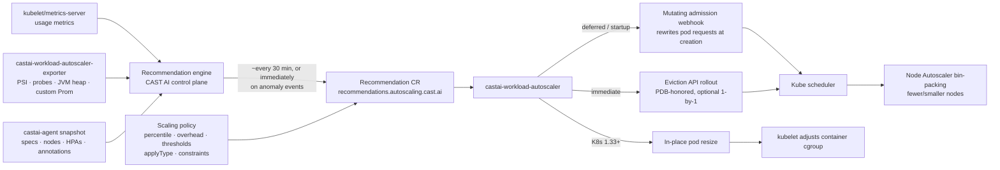

# Chapter 1 — Workload Autoscaler Architecture

Sources: [Overview](https://docs.cast.ai/docs/workload-autoscaling-overview) · [Configuration](https://docs.cast.ai/docs/workload-autoscaling-configuration) · [Helm charts](https://docs.cast.ai/docs/helm-charts) · [Hosted components](https://docs.cast.ai/docs/hosted-components)

## 1.1 What Workload Autoscaler is (and is not)

Workload Autoscaler (WAS) automatically scales workload **resource requests** up or down "to ensure optimal performance and cost-effectiveness." It is Kubernetes-native Vertical Pod Autoscaler behavior, implemented as a CAST AI-managed control plane + in-cluster apply path, plus an optional **native HPA (autoscaling/v2) management layer**.

It is **not** a node provisioner. It changes pod requests; it never adds/removes nodes. Node-side savings come from the separate **Node Autoscaler** acting on the reduced demand (bin-packing, rebalancing, deprovisioning). Distinguish the three axes:

| Mechanism | Changes | Triggered by | Owner |
|---|---|---|---|
| Workload Autoscaler (vertical) | CPU/memory requests (and optionally limits) | Usage percentiles, surges, OOM, PSI stalls | `castai-workload-autoscaler` |
| Managed/native HPA (horizontal) | Replica count | Utilization vs. target | Kubernetes HPA controller (config reconciled by WAS) |
| Node Autoscaler | Nodes/instance types | Unschedulable pods, underutilization | `castai-agent` + cluster controller |

## 1.2 Component roles

WAS ships as **two Helm charts** inside the umbrella chart ([source](https://docs.cast.ai/docs/workload-autoscaling-configuration#components)):

| Component | Role |
|---|---|
| `castai-workload-autoscaler` | Generates nothing itself — it **applies** recommendation CRs: runs the mutating admission webhook (rewrites pod requests at creation), executes immediate-mode rollouts via the Eviction API, performs in-place resizes, reconciles managed HPA objects, re-optimizes after OOM. HA since v0.30.0: **2 replicas** with anti-affinity; only one actively reconciles. |
| `castai-workload-autoscaler-exporter` | Metrics collection DaemonSet: node-level PSI stall metrics (K8s ≥1.34), startup probe-failure metrics, JVM heap metrics (via auto-instrumentation), and any connected **custom metrics** Prometheus data sources. |
| `castai-agent` | Cluster heartbeat + snapshots (workload specs, nodes, pods) to the CAST AI control plane; executes agent-side actions. |
| **CAST AI control plane** (SaaS) | Owns the **recommendation engine** (the "brain"): consumes metrics + snapshots, computes percentile targets, writes `Recommendation` CRs into the cluster **via the cluster controller**. This is why **automated optimization mode is required** for WAS ([overview](https://docs.cast.ai/docs/workload-autoscaling-overview#getting-started)). |

```
cluster controller  → creates/updates Recommendation CRs (from control plane)
workload-autoscaler → reads CRs, applies via webhook/eviction/resize
exporter            → feeds supplemental in-cluster metrics
agent               → cluster state snapshots, event reporting
```

## 1.3 The recommendation lifecycle



- **Cadence:** recommendations are generated **about every 30 minutes**; "it may take up to 30 minutes before the first recommendation... and the workload is updated" ([overview](https://docs.cast.ai/docs/workload-autoscaling-overview)).
- **Immediate generation triggers:** surge (average usage ≥50% over the current recommendation for 5+ minutes, sampled at 15s), **OOMKill**, and **CPU stall events**. These bypass the 30‑minute wait but still respect rollout dispatch delays and downscale cooldowns so frequent corrections do not restart workloads.
- **Event visibility:** every generate/apply/OOM/correction decision lands in the **Event log** ([event log](https://docs.cast.ai/docs/event-log)) and is retrievable via `ListWorkloadEvents` / console / OpsPilot.

## 1.4 Recommendation CRDs

Two CRDs power the loop; their presence tells you whether the cluster is properly onboarded:

```shell
kubectl get crd recommendations.autoscaling.cast.ai
kubectl get crd recommendationconfigs.autoscaling.cast.ai
kubectl get recommendations.autoscaling.cast.ai -A   # per-workload recommendations
```

A single-phase recommendation looks like (shape from the startup doc):

```yaml
apiVersion: autoscaling.cast.ai/v2
kind: Recommendation
metadata:
  name: nginx-deployment
spec:
  targetRef: {apiVersion: apps/v1, kind: Deployment, name: nginx}
  recommendation:
    - containerName: nginx
      requests: {cpu: 300m, memory: 300Mi}
```

Two-phase **startup recommendations** add `startup.duration` + `postStartup.recommendation` blocks ([startup docs](https://docs.cast.ai/docs/woop-startup-recommendations)). The deployed CR manifest per workload is exposed over the API: `WorkloadOptimizationAPI_GetWorkloadRecommendationManifest`.

## 1.5 How resource changes reach pods

| Path | When | Mechanism | Restarts? |
|---|---|---|---|
| **Admission webhook** | Deferred mode; any pod creation | Mutating webhook patches container requests (and per-policy limits) from the Recommendation CR | No extra restart — happens at natural pod birth |
| **Immediate rollout** | Immediate mode, thresholds exceeded | Eviction API delete → controller recreates pod → webhook applies new requests | Yes, PDB-honored (1-by-1 optional, `AllTogether` default) |
| **In-place resize** | K8s ≥1.33, eligible pods | Patch pod `resize` subresource; kubelet adjusts without restart where the container resize policy allows | Usually no (memory-limit decreases never done in place) |
| **Startup 2-phase** | Startup recommendations enabled | Admission applies original CPU requests → in-place resize to optimized values after the startup period | No |

Bypass rule: **unhealthy pods (OOMKilled, CrashLoopBackOff) are deleted directly**, skipping the Eviction API/PDB path — they're already disrupted ([configuration](https://docs.cast.ai/docs/workload-autoscaling-configuration#how-immediate-mode-applies-recommendations)).

## 1.6 Confidence, gradual scaling and rollout protection

- Recommendations carry a **confidence mark**; the UI darkens the mark as confidence grows with observation time.
- **`confidence.threshold`** (0–1): recommendations below it are not applied. Works instantly (no waiting period), unlike `confidence.required`. Annotations only.
- **`confidence.required`** (default `false`): when `true`, optimization begins only after enough data for high confidence. [Overview] recommends **not** enabling it — low-confidence recommendations already act conservatively and still floor OOMing workloads; low confidence also blocks fully automated immediate-mode downscales by itself.
- **Gradual scaling (new clusters ≤24h old: automatic):** downscales capped at **30%** per step with at least **3 confident recommendations** between immediate updates, and **no scale down below the configured min constraints** during the ramp window. Upscales are never capped (they fix latency/errors).
  - ⚠️ Known limitation (documented): policy-driven scale-down optimizations over a 24h period can mutually reset each other's 30% budget and cancel out; workaround = enable workloads one-by-one or via annotations initially.

## 1.7 Safety & platform integration points

- **Admission webhook** runs in `castai-agent` namespace with a 10s timeout; on visible dysfunction CAST AI fails open and **stops applying** changes (webhooks must not block pod creation).
- **PDBs** are enforced by the Eviction API. A blocking PDB surfaces as workload event "PDB is blocking eviction" ([event log](https://docs.cast.ai/docs/event-log)).
- **ResourceQuota / LimitRange**: WAS reads quota objects; optional ResourceQuota integration scales workloads without exceeding **available** namespace quota (headroom-aware). LimitRange `min`/`max`/`defaultRequest` values are respected — recommendations clamp inside them ([LimitRange integration](https://docs.cast.ai/docs/workload-autoscaling-configuration#limitrange-integration)).
- **AKS Admissions Enforcer** ([source](https://docs.cast.ai/docs/workload-autoscaling-overview#aks-admissions-enforcer-integration)): the WAS webhook disables the enforcer on its namespace via `admissions.enforcer/disabled: "true"` (v0.74.1+; chart value `webhook.aksAdmissionsEnforcerDisabled`, default `auto`). Revert: remove label + run `aks-linux-sizing-webhook` `RestoreTool`.
- **GKE Autopilot:** supported (limitations documented).

## 1.8 Reliability & HA

- `castai-workload-autoscaler` runs 2 replicas + anti-affinity (v0.30.0+); leader does the work, standby takes over.
- Rightsizing is event-safe: OOMKill immediately floors memory recommendations near peak usage ~×1.2 for ≥2h (see Chapter 5), surge events raise floors without spamming restarts.
- If CAST AI is unreachable, the last applied requests simply persist — recommendations are declarative CRs; there is no fail-closed throttling of workloads.
