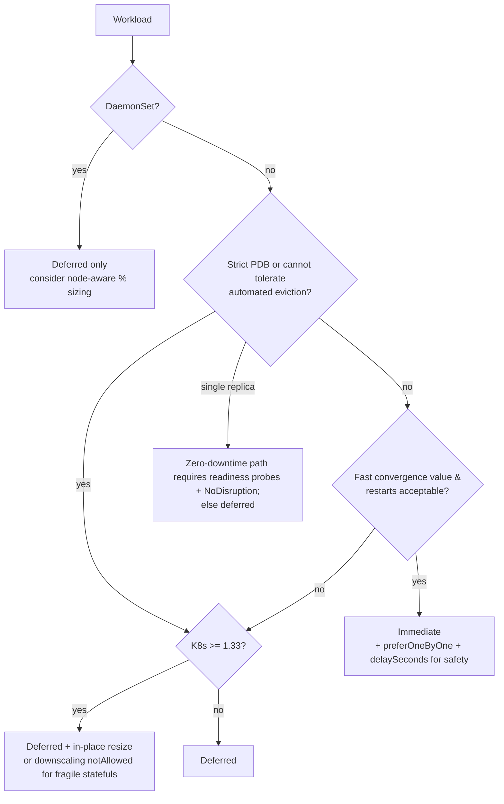

# Chapter 6 — Immediate vs Deferred vs In-Place Scaling

Sources: [Configuration → apply type](https://docs.cast.ai/docs/workload-autoscaling-configuration#recommendation-apply-type) · [Settings → horizontal/recommendation annotations](https://docs.cast.ai/docs/woop-configuration-settings) · [In-place resizing](https://docs.cast.ai/docs/woop-in-place-resizing) · [Startup recommendations](https://docs.cast.ai/docs/woop-startup-recommendations)

## 6.1 Comparison table

| | **Immediate** ([Default]) | **Deferred** | **In-place resize** (K8s 1.33+) |
|---|---|---|---|
| When rec calculated | ~30 min cadence + anomaly triggers | same | same |
| When applied | As soon as thresholds exceed | At natural pod recreation (deploy, node drain, crash) | Near-term, on running pods |
| Pod restart | **Yes** — Eviction API delete → recreate | No extra restart | Usually **no** |
| PDB honored | **Yes** (Eviction API) | n/a | n/a (no eviction); fallback honors PDB |
| Unhealthy pods | Deleted directly (bypasses Eviction API) — they're already down | — | — |
| Rollout strategy | `AllTogether` (default) or 1-by-1 (`evictOneByOne`), optional eviction **delay** | n/a | — |
| Availability | Synchronized recreates for same-config pods (they receive identical values); zero-downtime single-replica update path exists (v0.35.3+, prerequisites) | Never disrupts | Minimal disruption |
| Eligibility | Deployment, StatefulSet, Rollout, ReplicaSet, CronJob (not DaemonSet) | All supported kinds | Linux pods, QoS preserved, K8s ≥1.33, WAS ≥v0.53.0 (chart v0.1.122) |
| Fallback | — | — | Falls back to configured mode when incompatible/stuck |

## 6.2 Immediate mode details

- Applies via **eviction**, then the mutating webhook stamps new requests on the replacement pod.
- `rolloutBehavior`: `type: NoDisruption` + `preferOneByOne: true` + `delaySeconds: 120` = gentle, one-at-a-time rolling with a 2-minute settle gap between evictions ([annotations ref](https://docs.cast.ai/docs/workload-autoscaler-annotations-reference#rolloutbehavior)).
- Rollout protections: even for anomaly-triggered recs (surge/OOM), dispatch delays and cooldowns apply so corrections can't restart-loop a workload.
- **PDB-blocked applies** are visible as the event "PDB is blocking eviction" — nothing happens until budget allows.
- Upscaling cooldown removal (v1.9.5): upscale no longer blocked by the 24h downscale cooldown when usage has climbed.

## 6.3 Deferred mode details

- Recommendation CRs are stored; the webhook applies them to the **next** pod(s) the controller creates. Zero forced disruption; convergence depends on pod churn rate.
- **Zero-downtime single-replica updates** (v0.35.3+ immutable fix): a new pod with the new requests is created and traffic switched before removing the old — requires readiness probes + `NoDisruption` rollout behavior prerequisites from the settings doc.
- On K8s ≥1.33, deferred can fulfill recommendations via in-place resize instead of waiting for recreation.
- DaemonSets are **deferred-only** — no eviction path.

## 6.4 In-place pod resizing details (K8s 1.33+)

- Flow: compatibility check → patch pod resize → kubelet applies. `PodResizePending` is normal async behavior; stuck resizes (node lacks headroom): immediate mode eventually evicts; deferred waits.
- **Never decreases memory limits** in place (K8s best practice); removing CPU limits during first application may need a restart; container restart policies with `RestartContainer` resize policy force restarts for that resource.
- In-place is **complementary**, configured at the workload level via annotations with immediate/deferred as the base mode — enable in-place for workloads already on deferred to get near-immediate, low-disruption applies.
- Also the enabler for **startup recommendations** (two-phase CPU profile, Ch. 8).

## 6.5 Decision tree

**Never claim zero downtime** for immediate mode; only the single-replica zero-downtime path (with documented prerequisites) and in-place resizes approach it.

## 6.6 Temporary pause via eviction delay

To freeze just immediate-mode applications (e.g. during an incident) without disabling optimization: set workload/pod annotation **`workloads.cast.ai/apply-recommendations-not-before: <RFC3339>`** (e.g. `2050-11-24T22:00:00Z`), or Helm value `podPendingRecommendationsDelaySeconds`. Reaction events (surge, OOM) still apply but rollouts are dispatched only after the delay. Remove the annotation to resume.
