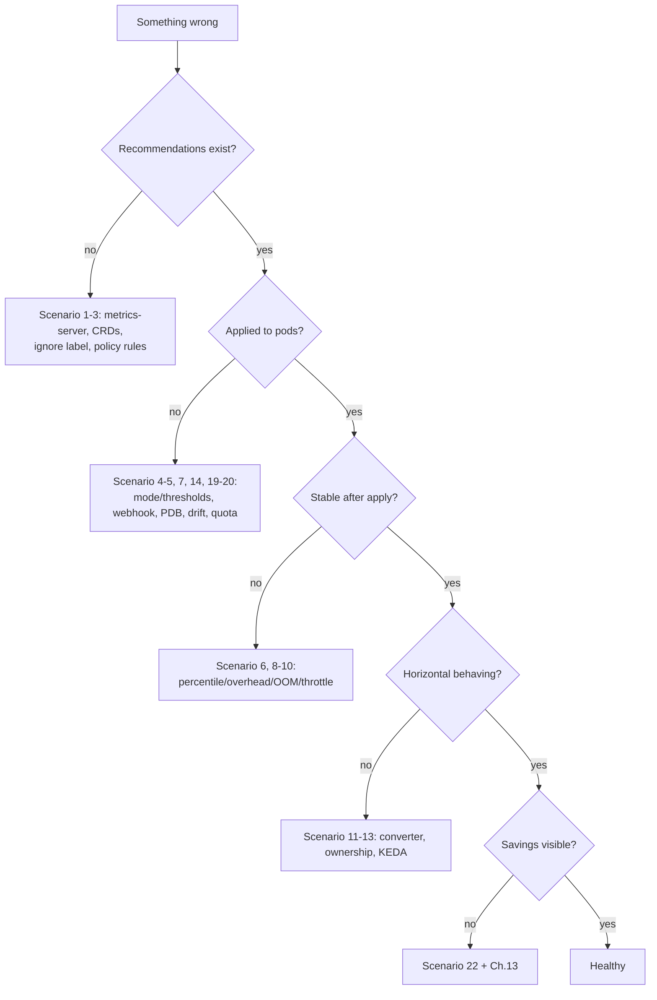

# Chapter 11 — Troubleshooting & Root-Cause Analysis

Sources: [Overview → Troubleshooting](https://docs.cast.ai/docs/workload-autoscaling-overview#troubleshooting) · [Event log](https://docs.cast.ai/docs/event-log) · [JVM](https://docs.cast.ai/docs/woop-jvm-optimization) · [Custom metrics](https://docs.cast.ai/docs/woop-custom-metrics) · [Configuration](https://docs.cast.ai/docs/workload-autoscaling-configuration) · [In-place resizing](https://docs.cast.ai/docs/woop-in-place-resizing) · [Optimization constraints](https://docs.cast.ai/docs/optimization-constraints)

**Golden first moves:** open the **Event log** (or ask OpsPilot "why did workload X get this recommendation?"), then `kubectl get recommendations.autoscaling.cast.ai -A`, then component pod health. Format per scenario: *Symptoms → Causes → Diagnose → Confirm → Fix → Rollback → Refs.*

### 1. No recommendations generated
- **Symptoms:** workload row exists, no rec after >30 min. **Causes:** metrics-server missing/broken; Recommendation CRDs missing; workload excluded/ignore label; policy optimization off; workload had no metrics in 7 days (e.g. monthly job).
- **Diagnose:** `kubectl get apiservice v1beta1.metrics.k8s.io`; `kubectl get crd | grep autoscaling.cast.ai`; check `workload-autoscaler.cast.ai/ignore` on pod template/namespace (`kubectl get deploy <d> -o jsonpath='{.spec.template.metadata.labels}'`, `kubectl get ns <ns> --show-labels`); console policy automation state.
- **Confirm/Fix:** fix metrics-server; install CRDs (onboarding path); remove ignore label, use **whitelisting mode** instead; enable optimization.
- **Rollback:** n/a. **Refs:** Overview → Troubleshooting.

### 2. Low recommendation confidence
- **Symptoms:** recs flagged low confidence; downscales blocked. **Cause:** <24h observation or thin metric density over the look-back (~40% needed); cluster hibernation pauses collection.
- **Fix:** wait; shorten look-back; lower `confidence.threshold` (e.g. 0.5–0.8) consciously; manually enable workload (bypasses gradual scaling). **Refs:** Settings → Confidence.

### 3. Workload not in the expected policy
- **Causes:** first-matching rule wins elsewhere; annotation `scalingPolicyName` pins deleted/renamed policy (event log warns *"Scaling policy '<name>' not found..."*). **Fix:** inspect rules/matching order (`SetScalingPoliciesOrder`), fix annotation.

### 4. Recommendations generated but not applied
- **Causes:** deferred mode + no pod churn; sensitivity Δ below threshold; confidence gate; eviction delay annotation set; constraints clamp to current values.
- **Diagnose:** `kubectl describe recommendation <name>`; check `apply-recommendations-not-before` annotation; compare Δ vs threshold.
- **Fix:** recreate pods (safe rollout) or switch to immediate; tune sensitivity.

### 5. Requests unchanged after apply
- **Causes:** webhook unreachable; whitelisting mode without the label; GitOps reverting; recommendation Δ below threshold. **Diagnose:** webhook `MutatingWebhookConfiguration`, `helm list -n castai-agent`, Argo sync status of the app. **Fix:** repair webhook (rollout restart of WAS deployment), add whitelist label, resolve Git drift (Ch. 9.3).

### 6. Pods repeatedly restarting after optimization
- **Causes:** aggressive percentile/overhead → throttling; JVM without heap sizing; sensitivity too tight (churn).
- **Diagnose:** `kubectl get events --field-selector reason=OOMKilled`; `rate(container_cpu_cfs_throttled_seconds_total[5m])`; event log cadence.
- **Fix:** raise percentile/overhead (memory first), enable JVM optimization, switch to `preferOneByOne`/deferred.

### 7. PDB blocks optimization
- **Symptom:** event **"PDB is blocking eviction"**. **Fix:** relax PDB (`maxUnavailable: 1`), use deferred mode, or `evictOneByOne` with delay. Don't delete the PDB to please the optimizer. **Refs:** event log; configuration immediate-mode section.

### 8. CPU throttling after rightsizing
- **Diagnose:** `kubectl top pod` vs requests; throttling metrics; CPU stall events.
- **Fix:** raise CPU overhead (cheapest), or percentile; check stall detection isn't fighting you (threshold settings); if HPA-managed, CPU knobs are ignored by design — tune the HPA target instead (Ch. 7.3).

### 9. OOMKilled workloads
- WAS auto-floors memory ~1.2× peak and re-applies immediately (bypassing rollout delay); 2h anti-flap. If OOMs repeat in <10-min loops, WAS may **auto-disable** the workload (event *"Optimization disabled"*).
- **Fix:** verify memory target = `max`, overhead ≥0.15; for Java enable heap-based sizing; re-enable the workload after stabilizing. **Refs:** Overview → Handling OOM events.

### 10. Memory pressure / node evictions
- **Causes:** limits removed or ratio changed globally; neighbors overcommitted. **Fix:** `maintainRatio`/`keepLimits`; check node `kubectl describe node` pressure events; review ResourceQuota-aware scaling (5.0 table).

### 11. HPA instability (thrash after enabling WAS)
- **Cause:** % targets drifting after rightsizing. **Fix:** add HPA converter (`AverageValueFromOriginalRequests`) or move to WAS-managed HPA; set scale-down stabilization 300–600s; ensure startup spikes handled (startup recommendations). **Refs:** settings → HPA converter.

### 12. HPA ownership conflicts
- **Symptoms:** workload reports incompatibility; HPA unchanged. **Cause:** third-party-owned (KEDA) or non-eligible metrics (external/container targets). **Fix:** keep third-party ownership (by design) or remove the third-party HPA and re-onboard. **Refs:** HPA → Taking ownership.

### 13. KEDA integration issues
- ScaledJobs unsupported; custom-metrics-only ScaledObjects get vertical-only optimization with no coordination — expected behavior, not a bug. Verify metric trigger types (Ch. 7.4).

### 14. Admission webhook failures
- **Symptoms:** pods stuck/patched inconsistently; WAS pods crashlooping. **Diagnose:** `kubectl get mutatingwebhookconfigurations`; `kubectl -n castai-agent logs deploy/castai-workload-autoscaler`; AKS → check `admissions.enforcer/disabled` label interaction.
- **Fix:** rollout restart WAS; verify cert/service network path; on AKS confirm enforcer handling (or run `aks-linux-sizing-webhook` `RestoreTool` if reverting). **Refs:** Overview → AKS admissions enforcer.

### 15. In-place resize stuck (`PodResizePending`)
- Usually node lacks allocatable headroom. Immediate mode eventually **evicts**; deferred **waits** for natural restart — both documented. Free node capacity (Node Autoscaler, evict low-priority pods); verify QoS class unchanged and no memory-limit decrease attempted.
- **Refs:** in-place doc → stuck pod resize reconciliation.

### 16. Incorrect startup recommendations
- **Checks:** `startup.period` too short vs real boot (extend; range 2–60m or custom); phases skipped if Δ<100m (by design); JVM heap sizing + startup recs → fallback to single-phase (documented).

### 17. Custom metrics missing/unhealthy
- `kubectl get pods -n castai-agent -l app.kubernetes.io/name=castai-workload-autoscaler-exporter` + logs (`--tail=50`); verify data source CR appears 2–3 min after creation; Prometheus URL/credentials reachable from cluster. **Refs:** custom metrics → Troubleshooting.

### 18. JVM heap metrics unavailable
- Java <9 for auto-instrumentation; options passed via entrypoint script instead of inline; security policy rejected the JMX init container (webhook/OPA denials in events). **Fix:** exception for WAS JMX init container, or endpoint scraping (`prometheus.io/*` annotations), or external Prometheus data source. **Refs:** JVM doc → Troubleshooting.

### 19. GitOps reverting resource changes
- Symptom: Argo/Flux sync loops on `resources:` fields. **Fix:** pick an ownership model (Ch. 9.3): remove resources from Git, run the APA sync-to-Git runbook, or `ignoreDifferences`. Never both.

### 20. ResourceQuota / LimitRange blocking changes
- **Fix:** enable **ResourceQuota-aware scaling** (+ headroom `allowedResourceQuotaHeadroomPercent`) per [Configuration → ResourceQuota](https://docs.cast.ai/docs/workload-autoscaling-configuration#resourcequota-aware-scaling); know that visible quota is synced (list via API `ListResourceQuotas`); LimitRange clamps are respected — adjust the LimitRange, not WAS.

### 21. WAS components unhealthy
- **Diagnose:** `kubectl get pods -n castai-agent`; exporter/WAS logs; `helm list -n castai-agent`; check HA pair scheduling (anti-affinity needs 2 schedulable nodes); memory limits too low on big clusters (docs' example: 5Gi/5G).
- **Fix:** bump resources, roll upgrade with self-test enabled (Ch. 2.6), rollback via `helm rollback`.

### 22. Optimization works but no savings visible
- **Causes:** nodes not consolidating (WAS-only mode → savings are *modeled/potential*); cluster <14 days old or baseline not computed (appears **absent**, not zero); looking at the wrong report section. **Fix:** enable Node Autoscaler or act on bin-packing yourself; read Ch. 13 for the right lens. **Refs:** savings-report, savings-baseline.

## Decision tree

